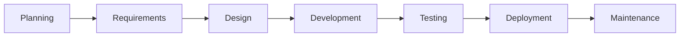

# Spec Kit phát triển Spec Kit như thế nào: một SDLC có agent

<!-- vi-banner:start -->

> [!NOTE]
> Đây là bản dịch tiếng Việt. Bản gốc: [English](../../guides/agentic-sdlc.md). Thuật ngữ được thống nhất theo [Bảng thuật ngữ](../GLOSSARY.md); khi có khác biệt, bản tiếng Anh là bản chính thức.

<!-- vi-banner:end -->

Quá trình phát triển của chính Spec Kit kết hợp công việc do agent thực hiện với cách bàn giao phần mềm
truyền thống. Agent đánh giá các yêu cầu tính năng, giúp phát triển những thay đổi lớn
và điều tra các lỗi được báo cáo. Dự án cũng dùng chính Spec Kit ở những chỗ
quy trình của nó phù hợp, trong khi test và phát hành tất định vẫn là các GitHub Actions
thông thường và maintainer là người quyết định tiếp tục hay merge.

Các workflow công khai và một tính năng trong lịch sử dự án là bằng chứng cho
nghiên cứu điển hình này. Chúng cho thấy các con đường khác nhau qua SDLC của dự án, bao gồm cả những chỗ
dự án dùng chính Spec Kit.

## Vòng đời phát triển phần mềm của dự án

Các giai đoạn truyền thống giúp định vị các cách làm của dự án trên toàn bộ SDLC.

Các giai đoạn này là bản đồ, không phải trình tự bắt buộc. Công việc có thể bắt đầu ở bất kỳ đâu
mà dữ liệu đầu vào và mục tiêu của nó đòi hỏi: một yêu cầu tính năng ở giai đoạn lập kế hoạch,
một thay đổi có sẵn ở giai đoạn kiểm thử, hoặc một báo cáo lỗi ở giai đoạn bảo trì. Các giai đoạn có thể
chồng lấn, lặp lại hoặc bị bỏ qua; một issue tính năng có thể làm đầu vào cho một lần đánh giá,
ghi lại yêu cầu và chứa thảo luận thiết kế. Các mũi tên thể hiện một con đường
quen thuộc, không phải các bước chuyển bắt buộc giữa các giai đoạn SDLC.
Phản hồi từ giai đoạn bảo trì có thể định hướng chu kỳ lập kế hoạch tiếp theo.

## Ai làm việc

Các phương thức dưới đây minh họa cách công việc được thực hiện ở đây; chúng không phải là một
hệ thống phân loại hay danh mục đầy đủ các hoạt động. Một giai đoạn có thể kết hợp nhiều phương thức.

**Tự động hóa thông thường.** Script và bot làm theo các quy tắc định sẵn để chạy
kiểm tra, đề xuất cập nhật thư viện phụ thuộc và phát hành. Chúng không
diễn giải yêu cầu tính năng hay chọn thiết kế.

**Tự động hóa bằng agent.** Một agent lập trình diễn giải ngữ cảnh và tạo ra một
bản đánh giá, các artifact SDD, một thay đổi được đề xuất hoặc một báo cáo kiểm thử. Nó có thể chạy
qua một lệnh Spec Kit do người đóng góp gọi, qua agent riêng của người đóng góp,
hoặc qua một workflow của repository được kích hoạt bằng label. Chạy agent trên GitHub
Actions không biến suy luận của nó thành một script tất định.

Dấu sao (&#9733;) đánh dấu công việc do agent thực hiện: đặt trước các đoạn văn và sau
các mục trong dòng thời gian. Biểu tượng người (&#128100;) làm nổi bật đóng góp của con người trong
phần mô tả từng giai đoạn, kể cả công việc được làm với sự trợ giúp của agent.

**Công việc của con người.** Con người có thể nêu vấn đề trong issue, thảo luận hướng đi, viết hoặc sửa
thay đổi, và review bằng chứng, có hoặc không có sự trợ giúp của agent. Maintainer
gắn label để khởi động workflow của repository và quyết định có tiếp tục
hay merge hay không. Những lần chuyển giao đó là quyết định của con người, không phải bằng chứng rằng con người
đã tự viết mọi bản đánh giá, đặc tả, bản sửa lỗi hay báo cáo kiểm thử.

## Dự án làm việc thế nào ở từng giai đoạn

### 1. Lập kế hoạch: đánh giá yêu cầu tính năng

Một tính năng có thể đi vào giai đoạn lập kế hoạch qua
[biểu mẫu yêu cầu tính năng](https://github.com/github/spec-kit/blob/main/.github/ISSUE_TEMPLATE/feature_request.yml).
Biểu mẫu hỏi về vấn đề, giải pháp đề xuất, các phương án thay thế, thành phần liên quan và các
tình huống sử dụng. Issue được tạo ra bắt đầu với `needs-triage`; việc tạo issue không
tự động khởi chạy agent.

&#9733; Khi một yêu cầu tính năng được gắn label để đánh giá,
[workflow agentic feature-assess](https://github.com/github/spec-kit/blob/main/.github/workflows/feature-assess.md)
cài Specify CLI từ bản checkout, cài [extension `assess`](assessment.md) đi kèm của Spec Kit,
và đi qua các bước intake, research, define,
shape và decide của nó. Agent đăng bằng chứng cùng kết luận `go`,
`needs-clarification` hoặc `kill` lên issue. **Đây là một workflow
agentic dùng chính Spec Kit.**

&#128100; Người đóng góp nêu yêu cầu; maintainer quyết định có
khởi động việc đánh giá hay không và hành động thế nào theo kết luận. Kết luận `go` là căn cứ cho
quyết định lập kế hoạch đó; nó không tự động mở PR tính năng hay
bắt đầu SDD.

### 2. Yêu cầu: ghi lại ý định trong issue hoặc đặc tả

&#128100; Người đóng góp có thể ghi lại các yêu cầu ban đầu ngay trong issue tính năng đó
qua phần mô tả vấn đề, tình huống sử dụng và tiêu chí chấp nhận, rồi
làm rõ hoặc sửa ý định trong quá trình thảo luận. Với một thay đổi có giới hạn, như vậy
có thể là đủ; nó không nhất thiết phải trở thành một `spec.md` của SDD.

&#9733; Với các thay đổi lớn, người đóng góp có thể mở rộng yêu cầu
bằng các lệnh SDD lõi của Spec Kit dựa trên hiến chương của dự án. Spec Kit
đã dùng quy trình này cho chính nó trong
[công việc bundler trước đây](https://github.com/github/spec-kit/commit/3fd1e54d4b237af6124bb967e2eae24c93685a89):
commit này chứa một hiến chương và đặc tả tính năng cho lệnh
`specify bundle`. Đây là bằng chứng của việc **tự dùng SDD (dogfooding) cho tính năng
đó**; công việc bundler khác với workflow `feature-assess`
hiện tại.
[Hướng dẫn đóng góp](https://github.com/github/spec-kit/blob/main/CONTRIBUTING.md#does-spec-kit-use-spec-kit)
yêu cầu người đóng góp kiểm thử các thay đổi liên quan bằng SDD, đồng thời cho phép các bản sửa nhỏ
đi theo quy trình issue và PR thông thường. Các artifact `specs/` được sinh ra
thường nằm trong gitignore; commit được liên kết lưu giữ một bản chụp lịch sử.

### 3. Thiết kế: chọn cách tiếp cận ở quy mô phù hợp

&#128100; Giải pháp đề xuất và các phương án thay thế trong biểu mẫu tính năng có thể làm hạt giống cho một
cuộc thảo luận thiết kế; người đóng góp và maintainer có thể tinh chỉnh cách tiếp cận
trong lúc review PR. Không phải issue nào cũng cần một kế hoạch SDD riêng.
Các thay đổi lớn hơn cần được thảo luận trước và thống nhất với maintainer, như
[hướng dẫn đóng góp](https://github.com/github/spec-kit/blob/main/CONTRIBUTING.md#submitting-a-pull-request)
đã giải thích. Khi các quyết định cần có giá trị lâu dài qua nhiều thay đổi, repository
lưu các tài liệu thiết kế cho [CLI](https://github.com/github/spec-kit/blob/main/design/cli.md),
[integration](https://github.com/github/spec-kit/blob/main/design/integration.md)
và [workflow-step](https://github.com/github/spec-kit/blob/main/design/workflow-step.md).

&#9733; [Bản chụp SDD của bundler](https://github.com/github/spec-kit/commit/3fd1e54d4b237af6124bb967e2eae24c93685a89)
minh họa con đường đi sâu hơn: kế hoạch, nghiên cứu, mô hình dữ liệu, contract và
danh sách tác vụ của nó biến thiết kế thành thứ có thể thực hiện qua `/speckit.plan` và
`/speckit.tasks`. Điều này cho thấy nơi chính Spec Kit đã được dùng mà không
coi mức chi tiết đó là mặc định cho mọi thay đổi.

### 4. Phát triển: tạo ra các thay đổi có thể review

[Phần triển khai bundler](https://github.com/github/spec-kit/pull/3070)
bổ sung `specify bundle` sau công việc SDD đã được ghi lại. Đây là một tính năng
cụ thể trong dự án được dẫn dắt bởi đặc tả. Các thay đổi có giới hạn khác dùng
quy trình issue, PR, review và kiểm thử thông thường.

&#128100; Người đóng góp có thể tự triển khai và sửa thay đổi, hoặc với sự trợ giúp của
agent. Maintainer review PR kết quả và bằng chứng đi kèm, kể cả
khi thay đổi được đề xuất là do agent tạo ra.

&#9733; Người đóng góp có thể dùng agent riêng, độc lập với các workflow của
repository. Vì công việc đó có thể không thể hiện trong diff,
[chính sách đóng góp](https://github.com/github/spec-kit/blob/main/CONTRIBUTING.md#ai-contributions-in-spec-kit)
yêu cầu khai báo công cụ, mô hình, thiết lập hoặc chế độ, và mức độ trợ giúp
của AI. Commit và bình luận do agent viết cần được ghi nguồn riêng;
các workflow sửa lỗi và catalog cộng đồng đã biết được miễn vì danh tính
agent của chúng là hiển nhiên. Việc khai báo cung cấp nguồn gốc, không hạ thấp yêu cầu
về bằng chứng hay review.

### 5. Kiểm thử: xác minh cả ý định lẫn hành vi

&#9733; Công việc bundler có một
[lượt hội tụ](https://github.com/github/spec-kit/commit/de1c8ce6765f07cd1c4728a251b95adbfa3a8d07)
đã bổ sung một tác vụ bị thiếu. Đây là một ví dụ về việc quy trình SDD của Spec Kit
đối chiếu phần triển khai với ý định thay vì coi lượt đầu tiên
là đã hoàn tất.
[Workflow bug-test](https://github.com/github/spec-kit/blob/main/.github/workflows/bug-test.md)
dùng agent để chọn các test liên quan, nhưng bản thân các lệnh test
vẫn chạy một cách tất định.

&#9733; Maintainer cũng có thể yêu cầu
[workflow pr-assess](https://github.com/github/spec-kit/blob/main/.github/workflows/pr-assess.md)
bằng cách gắn `pr-assess` vào một PR. Workflow so sánh phần mô tả với diff
tích lũy, báo cáo những thiếu sót hoặc mâu thuẫn đáng kể, và gắn một trong các label
`pr-description-aligned`, `pr-description-needs-update` hoặc
`pr-description-inconclusive`. Nó gỡ tối đa hai label kết quả cũ,
rồi chỉ thêm kết quả được chọn khi label đó chưa có. Nếu đã có đúng một kết quả trùng khớp thì
label được giữ nguyên; các kết quả mâu thuẫn được dọn dẹp mà không thay đổi
kết luận về phần mô tả chỉ vì sự mâu thuẫn đó.
Mỗi lần đánh giá hoàn tất đều đăng một bình luận độc lập mới, kể cả khi chạy lại
cho cùng kết quả. Các cập nhật được gợi ý chỉ dành cho phần mô tả, không phải phương án thay đổi code.
Bản MVP này dùng các thao tác gỡ/thêm riêng biệt, có thể thất bại một phần và không
làm cho việc sửa label thủ công đồng thời trở nên an toàn. Việc đăng bình luận cũng là thao tác riêng.
Workflow đọc thay đổi của repository và fork
mà không thực thi code của người đóng góp. Một issue bị gắn nhầm label hoặc một PR đã đóng sẽ nhận
bình luận giải thích, không nhận kết luận. Việc đánh giá lại là thủ công: gỡ rồi gắn lại
label kích hoạt. Bước này kiểm tra sự khớp của phần mô tả, không kiểm tra ý định của tác giả hay
chất lượng code nói chung, và không thay thế việc review của con người.

Bên cạnh đó, các GitHub Actions thông thường chạy
[Python test và Ruff](https://github.com/github/spec-kit/blob/main/.github/workflows/test.yml),
[lint Markdown cho tài liệu và ShellCheck cho script shell](https://github.com/github/spec-kit/blob/main/.github/workflows/lint.yml),
và [CodeQL](https://github.com/github/spec-kit/blob/main/.github/workflows/codeql.yml)
trên PR và khi push lên `main`. Việc hội tụ bằng agent bổ sung cho các bước kiểm tra
độc lập đó.

&#128100; Người đóng góp cung cấp test và bằng chứng tái hiện cho thay đổi;
maintainer đánh giá bản vá và bằng chứng có đáp ứng nhu cầu đã nêu hay không,
chứ không chỉ xem các bước kiểm tra có qua hay không.

### 6. Triển khai: phát hành không cần agent

Repository Spec Kit dùng GitHub Actions thông thường để bàn giao.
[Trình kích hoạt phát hành chạy thủ công](https://github.com/github/spec-kit/blob/main/.github/workflows/release-trigger.yml)
đặt phiên bản, tạo tag và mở PR phát hành. Tag kích hoạt một
[GitHub Release](https://github.com/github/spec-kit/blob/main/.github/workflows/release.yml)
thông thường.
Một workflow chạy thủ công riêng
[build và phát hành lên PyPI](https://github.com/github/spec-kit/blob/main/.github/workflows/publish-pypi.yml);
một thay đổi trong `docs/` trên `main` kích hoạt
[việc triển khai DocFX](https://github.com/github/spec-kit/blob/main/.github/workflows/docs.yml).
Các Actions thông thường này xử lý việc bàn giao tất định mà không cần agent
hay lệnh Spec Kit nào.

&#128100; Maintainer chọn thời điểm bắt đầu phát hành và quyết định có chỉ định
phiên bản hay dùng mức tăng patch tự động. Sau đó họ chạy thủ công
việc phát hành lên PyPI cho tag đó và review PR phát hành.

### 7. Bảo trì: điều tra, sửa chữa và rút kinh nghiệm

&#128100; Người báo lỗi cung cấp hành vi quan sát được, hành vi mong đợi và các bước tái hiện
qua
[biểu mẫu báo lỗi](https://github.com/github/spec-kit/blob/main/.github/ISSUE_TEMPLATE/bug_report.yml).
Maintainer phân loại báo cáo, chọn thời điểm yêu cầu từng bước agentic,
và review bản sửa được đề xuất cùng bằng chứng kiểm thử trước khi merge. Báo cáo có thể
xuất hiện trước hoặc sau khi phát hành; một nhu cầu mới được phát hiện có thể đưa vào chu kỳ
lập kế hoạch tiếp theo thay vì bị gộp vào một bản sửa.

&#9733; Repository dùng các workflow agentic riêng biệt
[bug-assess](https://github.com/github/spec-kit/blob/main/.github/workflows/bug-assess.md),
[bug-fix](https://github.com/github/spec-kit/blob/main/.github/workflows/bug-fix.md)
và [bug-test](https://github.com/github/spec-kit/blob/main/.github/workflows/bug-test.md)
trên issue. Chúng tách riêng chẩn đoán, khắc phục và
xác minh với các bước chuyển giao do con người kiểm soát; bản sửa được đề xuất dưới dạng PR nháp
để maintainer review. **Hiện tại các workflow của dự án
này không dùng
[extension `bug`](bugfix.md) đi kèm của Spec Kit**, dù extension đó cung cấp quy trình
assess, fix, test tương ứng cho người dùng. Việc để các workflow dùng extension đó
là một hướng phát triển trong tương lai, không phải khả năng hiện có hay một bản phát hành
đã hứa hẹn.

Cả workflow agentic lẫn workflow thông thường đều chạy trên GitHub Actions. Điều khác biệt
là có agent diễn giải bằng chứng hay đề xuất thay đổi hay không.
[Dependabot](https://github.com/github/spec-kit/blob/main/.github/dependabot.yml)
cũng đề xuất PR cập nhật thư viện phụ thuộc pip và GitHub Actions hằng tuần để
maintainer review; đây là tự động hóa thông thường, không phải workflow agentic.

## Khả năng mở rộng và thực tiễn cộng đồng

Khả năng mở rộng xuyên suốt SDLC này: dự án vừa xây dựng và phân phối
quy trình vừa sử dụng chúng. Nhóm phát hành
[bundle `assess`](https://github.com/github/spec-kit/tree/main/bundles/assess)
và [bundle `bugfix`](https://github.com/github/spec-kit/tree/main/bundles/bugfix),
mỗi bundle kết hợp một extension với một *workflow Spec Kit* có thể tiếp tục giữa chừng và một cổng
review của con người. Nhóm cũng phát hành
[preset `lean`](https://github.com/github/spec-kit/tree/main/presets/lean)
để minh họa một cách khác để định hình hướng dẫn SDD lõi. Đây là
[extension, preset, workflow và bundle](customization.md) của chính Spec Kit,
không phải các workflow GitHub Actions của repository.

&#9733; Ngoài việc bàn giao tính năng lõi, các workflow agentic xử lý đóng góp của cộng đồng cho
[extension](https://github.com/github/spec-kit/blob/main/.github/workflows/add-community-extension.md),
[preset](https://github.com/github/spec-kit/blob/main/.github/workflows/add-community-preset.md),
[bundle](https://github.com/github/spec-kit/blob/main/.github/workflows/add-community-bundle.md)
và [workflow step](https://github.com/github/spec-kit/blob/main/.github/workflows/add-community-workflow-step.md)
kiểm tra metadata của bài gửi và đề xuất thay đổi catalog trong PR nháp để
maintainer review.

Tiêu đề bài gửi extension, preset và bundle lần lượt phải có tiền tố `[Extension]:`,
`[Preset]:` và `[Bundle]:`. Nếu không khớp, bài gửi sẽ nhận một bình luận
kèm link tới lần chạy, rồi quá trình xử lý dừng lại mà không kiểm tra hay thay đổi gì khác.

Việc được tìm thấy qua catalog không có nghĩa là code cộng đồng đã được kiểm định hay bảo chứng; người dùng phải
review các thành phần của bên thứ ba trước khi sử dụng.

## Chúng tôi đã đi từ SDLC đến SDLC có agent như thế nào

Các cách làm agentic được bổ sung dần vào một SDLC sẵn có, không thay thế cho
các bước kiểm tra và phát hành thông thường. Lịch sử commit cho thấy sự kết hợp đó
hình thành theo thời gian ra sao. Đây là các mốc được chọn lọc, không phải một changelog
đầy đủ. Cùng dấu sao đó đánh dấu các mốc agentic, bao gồm việc dùng quy trình SDD
của Spec Kit; tự động hóa và chính sách thông thường không được đánh dấu.

| Tháng | Điều gì thay đổi |
| --- | --- |
| Tháng 8/2025 | <ul><li><a href="https://github.com/github/spec-kit/commit/28fdfaa8">Tự động hóa GitHub Release</a> được bổ sung.</li></ul> |
| Tháng 9/2025 | <ul><li><a href="https://github.com/github/spec-kit/commit/4b98c20f">Triển khai tài liệu</a> được bổ sung.</li><li><a href="https://github.com/github/spec-kit/commit/6f3e450c">Hướng dẫn đóng góp</a> bắt đầu yêu cầu khai báo việc dùng AI hỗ trợ, kể cả agent do người đóng góp tự chạy.</li></ul> |
| Tháng 10/2025 | <ul><li><a href="https://github.com/github/spec-kit/commit/33a07969">Lint Markdown</a> được bổ sung vào các bước kiểm tra PR và <code>main</code>.</li></ul> |
| Tháng 2/2026 | <ul><li><a href="https://github.com/github/spec-kit/pull/1622">Dependabot</a> bắt đầu đề xuất PR cập nhật thư viện phụ thuộc pip và GitHub Actions hằng tuần.</li><li>Một <a href="https://github.com/github/spec-kit/commit/9402ebd0">workflow CodeQL</a> được bổ sung để quét code.</li><li><a href="https://github.com/github/spec-kit/pull/1637">Pytest CI</a> bắt đầu chạy test trên PR và khi push lên <code>main</code>.</li><li><a href="https://github.com/github/spec-kit/pull/1637">Lint bằng Ruff</a> được bổ sung vào workflow CI Python.</li></ul> |
| Tháng 5/2026 | <ul><li><a href="https://github.com/github/spec-kit/pull/2655">Bài gửi extension</a> có thêm bước kiểm tra catalog và PR nháp. &#9733;</li><li><a href="https://github.com/github/spec-kit/pull/2655">Bài gửi preset</a> có thêm bước kiểm tra catalog và PR nháp. &#9733;</li></ul> |
| Tháng 6/2026 | <ul><li>Một <a href="https://github.com/github/spec-kit/pull/3023">workflow agentic bug-assess</a> được bổ sung. &#9733;</li><li><a href="https://github.com/github/spec-kit/commit/3fd1e54d4b237af6124bb967e2eae24c93685a89">Tính năng bundler</a> dùng quy trình SDD của Spec Kit để tạo đặc tả, kế hoạch và danh sách tác vụ. &#9733;</li><li><a href="https://github.com/github/spec-kit/pull/2915">Phát hành lên PyPI</a> có một workflow thông thường.</li><li><a href="https://github.com/github/spec-kit/pull/3126">ShellCheck</a> bắt đầu kiểm tra script shell trong CI.</li></ul> |
| Tháng 7/2026 | <ul><li><a href="https://github.com/github/spec-kit/pull/3258">Bug-fix</a> mở rộng workflow agentic trên issue với một bước chuyển giao cho con người. &#9733;</li><li><a href="https://github.com/github/spec-kit/pull/3257">Bug-test</a> bổ sung một bước xác minh riêng. &#9733;</li><li><a href="https://github.com/github/spec-kit/pull/3553">Bài gửi bundle</a> có thêm tự động hóa catalog. &#9733;</li></ul> |
| Tháng 8/2026 | <ul><li><a href="https://github.com/github/spec-kit/pull/4186">Workflow feature-assess</a> bắt đầu dùng extension <code>assess</code> của Spec Kit cho các yêu cầu tính năng. &#9733;</li></ul> |
| Tháng 9/2026 | <ul><li><a href="https://github.com/github/spec-kit/pull/4512">Khai báo AI</a> bắt đầu yêu cầu nêu agent, mô hình, thiết lập và mức độ.</li><li><a href="https://github.com/github/spec-kit/pull/4752">Hướng dẫn đóng góp</a> bổ sung việc ghi nguồn cho commit và bình luận do agent viết.</li></ul> |

Đây không phải là việc chuyển giao từ tự động hóa thông thường sang agent. Test, lint,
quét code và phát hành giữ các công việc lặp lại trong GitHub Actions, còn
việc khai báo giúp các agent do người đóng góp tự chạy trở nên minh bạch. Dự án bổ sung các workflow
agentic cho catalog và lỗi để xử lý các tác vụ có giới hạn, dùng SDD cho một tính năng
lớn, và về sau để việc đánh giá tính năng dùng extension `assess`
của Spec Kit. Đây là các bổ sung riêng lẻ, không phải các bước mà mọi issue đều phải đi qua.

Gộp lại, chúng mang đến cho dự án nhiều lựa chọn. Với tính năng, `assess` có thể làm căn cứ cho
quyết định của con người về một yêu cầu; công việc triển khai lớn có thể dùng SDD
để đặc tả và lập kế hoạch, như bundler đã làm. Không có bước chuyển giao tự động
giữa các quy trình đó. Một thay đổi nhỏ có thể chỉ cần một issue và một PR, còn
một lỗi có thể đi qua các bước đánh giá, sửa chữa và xác minh có cổng kiểm soát của con người.
Thay đổi code vẫn phải qua các bước kiểm tra thông thường và review của maintainer; kết luận trên
issue và đề xuất catalog có cổng kiểm soát của con người riêng.

## Một cách làm thực tế, không phải công thức bắt buộc

Với dự án mã nguồn mở công khai này, một issue mới là đầu vào không đáng tin cậy, không phải
sự cho phép để chạy agent. Maintainer kích hoạt từng workflow agentic thuộc
repository bằng label tương ứng và quyết định khi nào công việc được đi tiếp; người đóng góp
cũng có thể dùng agent riêng, miễn là khai báo và qua review. Đây là các
ranh giới có chủ đích của dự án này, không phải giới hạn vốn có của Spec Kit.

Một dự án đóng với mô hình tin cậy khác có thể tự động hóa nhiều bước chuyển giao hơn
giữa đánh giá, đặc tả, triển khai và kiểm thử, trong khi vẫn
giữ quyền hạn, bằng chứng và review tương xứng với rủi ro. Cách kết hợp
trong thực tế của Spec Kit không phải công thức bắt buộc: các nhóm có thể áp dụng agent ở
những chỗ khác nhau, có hoặc không có quy trình của Spec Kit. Cách kết hợp đó có thể thay đổi
theo nhu cầu và cách làm việc của dự án.

Ở đây, agentic không có nghĩa là không có con người: người đóng góp vẫn mang đến vấn đề,
yêu cầu và thay đổi; maintainer định hướng sản phẩm, dẫn dắt
việc bàn giao và review bằng chứng. Tự động hóa thông thường xử lý các bước kiểm tra
lặp lại và việc phát hành, còn agent hỗ trợ các công việc có giới hạn cần
diễn giải. Sự phân công này nhằm dồn thời gian của con người vào việc ra quyết định, dù
dòng thời gian chỉ cho thấy quá trình áp dụng chứ không đo lường được thời gian tiết kiệm.
