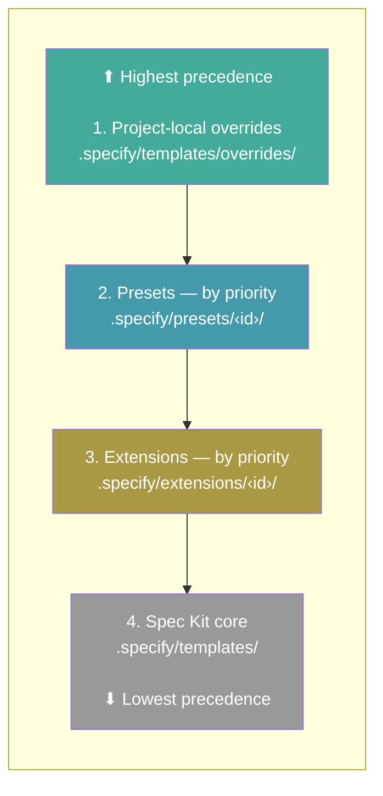
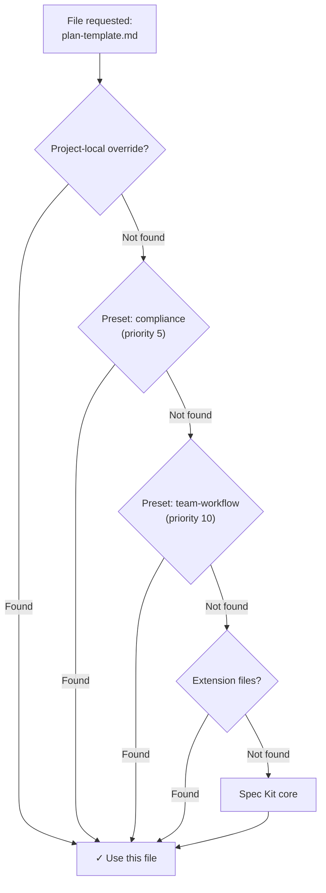

<a id="presets"></a>

# Preset

<!-- vi-banner:start -->

> [!NOTE]
> Đây là bản dịch tiếng Việt. Bản gốc: [English](../../reference/presets.md). Thuật ngữ được thống nhất theo [Bảng thuật ngữ](../GLOSSARY.md); khi có khác biệt, bản tiếng Anh là bản chính thức.

<!-- vi-banner:end -->

Preset tùy biến cách Spec Kit hoạt động — ghi đè template, lệnh và thuật ngữ mà không thay đổi công cụ nào. Chúng cho phép bạn áp dụng tiêu chuẩn của tổ chức, điều chỉnh workflow theo phương pháp của bạn, hoặc bản địa hóa toàn bộ trải nghiệm. Nhiều preset có thể xếp chồng theo thứ tự ưu tiên.

<a id="search-available-presets"></a>

## Tìm preset có sẵn

```bash
specify preset search [query]
```

| Tùy chọn | Mô tả |
| ---------- | -------------------- |
| `--tag` | Lọc theo tag |
| `--author` | Lọc theo tác giả |

Tìm trong mọi catalog đang hoạt động các preset khớp từ khóa. Khi không có từ khóa, liệt kê mọi preset có sẵn.

<a id="install-a-preset"></a>

## Cài một preset

```bash
specify preset add [<preset_id>]
specify preset add <preset_id> --version <version>
```

| Tùy chọn | Mô tả |
| --------------------- | -------------------------------------------------------------------- |
| `--dev <path>` | Cài từ thư mục cục bộ (để phát triển) |
| `--from <url>` | Cài từ URL tùy chỉnh thay vì từ catalog |
| `--version <version>` | Chọn đúng một bản phát hành từ catalog thắng (chỉ khi cài theo ID) |
| `--priority <N>` | Độ ưu tiên phân giải (mặc định: 10; nhỏ hơn = ưu tiên cao hơn) |

Cài một preset từ catalog, URL hoặc thư mục cục bộ. Lệnh của preset được tự động đăng ký với các integration agent lập trình AI đang hoạt động được hỗ trợ. Integration generic hiện cung cấp lời gọi extension nhưng không đăng ký ghi đè lệnh hay skill của preset. Không thể kết hợp `--version` với `--from` hoặc `--dev`. Cài trực tiếp từ URL vẫn độc lập với việc tra cứu catalog. Khi không có `--version`, việc cài đặt vẫn chọn bản phát hành hiện tại được công bố (hoặc preset đóng gói sẵn cục bộ). Bản phát hành được yêu cầu mà không có trong catalog thắng là lỗi; catalog ưu tiên thấp hơn không thể cung cấp nó. Catalog chỉ tìm kiếm không thể cài bất kỳ bản phát hành nào. Cài từ catalog theo phiên bản cụ thể sẽ xác minh ID và phiên bản trong `preset.yml` của archive được chọn trước khi sửa các preset đã cài. Bản phát hành lịch sử cần digest SHA-256, digest này cũng được xác minh khi tải; bản phát hành hiện tại kiểu cũ có thể không có digest.

> **Lưu ý:** Mọi lệnh preset đều yêu cầu dự án đã được khởi tạo bằng `specify init`.

<a id="exclude-development-files-with-presetignore"></a>

### Loại trừ file phát triển bằng `.presetignore`

Đặt một file `.presetignore` UTF-8 (có hoặc không có byte-order mark) cạnh `preset.yml` trong thư mục gốc nguồn của preset để lọc các file được sao chép vào `.specify/presets/<id>/`. Ví dụ:

```gitignore
# Development-only directories
.git/
.idea/
tests/
```

Việc lọc áp dụng cho cài đặt từ thư mục cục bộ và archive đã giải nén, kể cả khi cài lại và các bản thay thế do `preset update` cài. Khi không có `.presetignore`, mọi file nguồn đều được sao chép như trước. **`.gitignore` không được dùng để lọc khi cài đặt**, và không có loại trừ ngầm định nào cho file phát triển.

Các mẫu dùng cùng cách so khớp và chuẩn hóa kiểu Git như `.extensionignore`:

- Mỗi dòng một mẫu; dòng trống và comment `#` bị bỏ qua.
- `*` và `?` không vượt qua ranh giới thư mục; `**` có thể khớp xuyên thư mục.
- Dấu `/` ở cuối chỉ khớp thư mục. Dấu `/` ở đầu, hoặc dấu `/` bên trong mẫu ngoài dấu gạch chéo ở cuối, neo mẫu vào thư mục gốc nguồn. Mẫu không có dấu gạch chéo như vậy khớp tên ở mọi độ sâu.
- Một mẫu `!` phía sau sẽ đưa mục đã khớp trở lại. Thư mục bị loại trừ sẽ không được duyệt, nên không thể đưa một mục con trở lại khi thư mục cha vẫn bị loại trừ.
- Khoảng trắng của mẫu được cắt bỏ và dấu gạch chéo ngược được chuẩn hóa thành `/`, khớp với hành vi hiện có của extension. Dùng UTF-8 cho tên ngoài ASCII.

Để chỉ giữ `docs/api.md` trong `docs/`, hãy loại trừ nội dung của thư mục thay vì chính thư mục đó:

```gitignore
docs/*
!docs/api.md
```

Dùng `docs/`, rồi `!docs/` và `!docs/api.md`, sẽ đưa trở lại mọi file trong `docs/`, không chỉ `api.md`, trừ khi các mẫu khác loại trừ chúng.

Chỉ `.presetignore` ở thư mục gốc nguồn được đọc; file ignore lồng bên trong không thêm quy tắc. Khi có `.presetignore` ở gốc, các file tên `.presetignore` ở mọi độ sâu đều bị loại trừ, kể cả khi bị phủ định. Nếu không, các file `.presetignore` lồng bên trong được sao chép nguyên vẹn. File manifest và các file asset đã khai báo không được miễn lọc: hãy giữ `preset.yml` và mọi template, lệnh hoặc script mà preset cần. Loại trừ chúng có thể khiến bản cài đặt không đầy đủ hoặc không dùng được.

Với thư mục cục bộ và archive đã giải nén, trình cài đặt từ thư mục nguồn đọc và kiểm tra `.presetignore` trước khi xóa thư mục đích hiện có, kể cả khi cài lại cưỡng bức. UTF-8 không hợp lệ hoặc mẫu sai định dạng gây ra lỗi kiểm tra preset. Lệnh `preset update` riêng biệt vẫn giữ hành vi gỡ-rồi-thêm được mô tả bên dưới; nó không kiểm tra trước file ignore của bản thay thế trước khi gỡ.

<a id="update-a-preset"></a>

## Cập nhật preset

```bash
specify preset update <preset_id> [--from <url>] [--dev <path>] [--priority <N>]
```

Thay thế một preset đã cài bằng cách chạy thao tác `preset remove` thông thường trước, rồi đến thao tác `preset add` thông thường. `--from`, `--dev` và `--priority` được chuyển tiếp cho `preset add`; không thể kết hợp `--from` và `--dev`. Khi không có nguồn chỉ định rõ, add sẽ phân giải preset qua cách tra cứu thông thường trong gói đi kèm và catalog.

Update có tính phá hủy một cách có chủ ý. Đối số được kiểm tra trước khi xóa bất cứ thứ gì: Không thể kết hợp `--from` và `--dev`, `--priority` phải từ 1 trở lên, và preset phải đã được cài. Ngoài các kiểm tra đó, bản thân nguồn thay thế không được kiểm tra trước. Nếu gỡ thành công nhưng cài bản thay thế thất bại, preset trước đó đã bị gỡ. Lệnh sẽ báo một lệnh `specify preset add` có thể sao chép để thử lại, bao gồm nguồn thay thế và độ ưu tiên. Trên Windows, lệnh được báo được định dạng rõ ràng cho PowerShell. Không có kiểm tra trước nguồn, so sánh phiên bản, diff manifest, staging, rollback, tự sửa chữa hay giao dịch khôi phục. Do đó, nguồn thay thế bị thiếu hoặc không hợp lệ có thể khiến preset bị gỡ. Với `--from` hoặc `--dev`, `preset.id` của manifest thay thế không được đối chiếu với ID được yêu cầu trước khi gỡ; vì vậy một nguồn khai báo ID khác có thể cài một preset khác sau khi preset được yêu cầu đã bị gỡ.

Một lần cập nhật thành công tuân theo hành vi remove và add thông thường: nó bật lại preset, tạo lại `installed_at`, xóa các chỉnh sửa cục bộ được preset theo dõi, và coi `--from` hoặc `--dev` chỉ định rõ là một thay đổi nguồn có chủ ý. Nếu bật đồng bộ constitution, cả hai lượt đối chiếu thông thường đều chạy. Nếu add thất bại sau khi gỡ, constitution được sinh ra có thể vẫn được đối chiếu với chồng không còn preset đã gỡ. Cơ chế bảo vệ file được sinh vẫn bảo vệ `.specify/memory/constitution.md` đã được chỉnh sửa thủ công. Không có tối ưu hóa constitution riêng cho update, nên các lượt remove và add thông thường có thể ghi lại constitution được sinh ra ngay cả khi nội dung phân giải cuối cùng không đổi.

<a id="remove-a-preset"></a>

## Gỡ preset

```bash
specify preset remove <preset_id>
```

Gỡ một preset đã cài và dọn dẹp các lệnh đã đăng ký của nó.

<a id="list-installed-presets"></a>

## Liệt kê preset đã cài

```bash
specify preset list
specify preset list --json
```

Liệt kê các preset đã cài với phiên bản, mô tả, số lượng template và trạng thái hiện tại.

`--json` ghi một mảng JSON ra stdout. Mỗi phần tử có các khóa `id`, `name`, `description`, `version`, `author`, `priority`, `enabled`, `source` và `provides`. `author` là `null` khi không có; `source` là `{"kind":"local"}` với nguồn gốc cục bộ, kiểu cũ hoặc sai định dạng, hoặc `{"kind":"catalog","catalog":"<catalog-name>"}` với nguồn catalog hợp lệ. `provides` của preset chứa số lượng `commands`, `templates` và `scripts`. Khi thành công, `--json` ghi đúng một mảng ra stdout và thoát với mã 0. Lỗi runtime sau khi phân tích tùy chọn ghi đúng một đối tượng `{"error":"..."}` ra stderr và thoát với mã 1. Nếu việc phân tích phát sinh lỗi cách dùng và có token `--json` nguyên văn, nó ghi đối tượng lỗi JSON đó ra stderr và giữ nguyên mã thoát của lỗi cách dùng (thường là 2). Khi không có `--json`, kể cả với help, hành vi hiển thị cho người đọc hiện có không thay đổi.

Các preset được in theo **thứ tự phân giải/ưu tiên**: preset có độ ưu tiên cao nhất (số priority nhỏ nhất) được liệt kê đầu tiên, và khi trùng priority thì sắp theo bảng chữ cái của preset id. Thứ tự này khớp với thứ tự dùng khi kết hợp lệnh và phân giải template, nên mục trên cùng là mục thắng với các file chồng lấn.

<a id="preset-info"></a>

## Thông tin preset

```bash
specify preset info <preset_id>
specify preset info <preset_id> --versions
specify preset info <preset_id> --json
```

Hiển thị thông tin chi tiết về một preset đã cài hoặc có sẵn, gồm template, metadata và tag của nó. `--versions` liệt kê phiên bản hiện tại được công bố, theo sau là các phiên bản lịch sử trong catalog, kể cả với mục chỉ tìm kiếm; việc liệt kê không khiến chúng cài được. Chế độ xem này tra cứu catalog thay vì preset đã cài.

`--json` mô tả một preset đã cài, khớp theo ID, và ghi một đối tượng JSON duy nhất ra stdout. Đối tượng có cùng các khóa `id`, `name`, `description`, `version`, `author`, `priority`, `enabled` và `source` như mục tương ứng của `specify preset list --json`. Thay cho số lượng `provides`, nó có các mảng `commands`, `templates` và `scripts`, mỗi mục tương ứng một đóng góp trong manifest theo thứ tự khai báo. Mỗi mục có `name`, `description` (`""` khi thiếu hoặc rỗng), `source` (`{"layer": "preset", "presetId": "<id>"}`, preset cung cấp mục đó; `source` cấp cao nhất là nơi nó được cài từ đó), `sourcePath` (`file` trong manifest, tương đối với thư mục preset) và `strategy` (`replace`, `prepend`, `append` hoặc `wrap`; là `replace` khi manifest bỏ trống). Không thể kết hợp `--json` với `--versions` (lỗi cách dùng, mã thoát 2). Một preset chưa được cài (kể cả preset chỉ có trong catalog), hoặc dự án bị thiếu, sẽ ghi một đối tượng `{"error":"..."}` ra stderr và thoát với mã 1; lỗi cách dùng giữ nguyên mã thoát (thường là 2), giống `list --json`.

<a id="resolve-a-file"></a>

## Phân giải một file

```bash
specify preset resolve <name>
```

Cho biết file nào sẽ được dùng cho một tên nhất định bằng cách lần theo toàn bộ chồng phân giải. Hữu ích khi gỡ lỗi trường hợp nhiều preset cung cấp cùng một file.

<a id="enable--disable-a-preset"></a>

## Bật / tắt preset

```bash
specify preset enable <preset_id>
specify preset disable <preset_id>
```

Tắt một preset mà không gỡ nó. Preset bị tắt sẽ bị bỏ qua khi phân giải file nhưng các lệnh của nó vẫn được đăng ký. Bật lại bằng `enable`.

<a id="set-preset-priority"></a>

## Đặt độ ưu tiên preset

```bash
specify preset set-priority <preset_id> <priority>
```

Thay đổi độ ưu tiên phân giải của một preset đã cài. Số nhỏ hơn được ưu tiên. Khi nhiều preset cung cấp cùng một file, preset có số priority nhỏ nhất sẽ thắng.

<a id="catalog-management"></a>

## Quản lý catalog

Catalog preset kiểm soát nơi `search` và `add` tìm preset. Catalog được kiểm tra theo thứ tự ưu tiên (số nhỏ hơn = ưu tiên cao hơn).

> **File `.specify/preset-catalogs.yml` của một dự án có thể trỏ `add` và `search` tới một catalog bạn không chọn.** Trước khi cài preset trong một dự án lạ, hãy chạy `specify preset catalog list` và kiểm tra mọi catalog được đánh dấu cho phép cài — việc một dự án cung cấp cấu hình đó, hoặc đánh dấu một catalog cho phép cài, không phải bằng chứng các preset của nó đã được review. Chỉ đánh dấu `install_allowed` cho catalog do bạn tạo hoặc đã tự kiểm định; để các catalog lạ và catalog cộng đồng ở chế độ chỉ tìm kiếm.

<a id="list-catalogs"></a>

### Liệt kê catalog

```bash
specify preset catalog list
```

Hiển thị mọi catalog đang hoạt động cùng độ ưu tiên và quyền cài đặt của chúng.

<a id="add-a-catalog"></a>

### Thêm catalog

```bash
specify preset catalog add <url>
```

| Tùy chọn | Mô tả |
| -------------------------------------------- | -------------------------------------------------- |
| `--name <name>` | Bắt buộc. Tên duy nhất cho catalog |
| `--priority <N>` | Độ ưu tiên (mặc định: 10; nhỏ hơn = ưu tiên cao hơn) |
| `--install-allowed / --no-install-allowed` | Có thể cài preset từ catalog này hay không (mặc định: chỉ tìm kiếm). Chỉ bật cho catalog bạn sở hữu và kiểm định; không bao giờ bật cho catalog công khai chưa được kiểm định. |
| `--description <text>` | Mô tả tùy chọn |

Thêm một catalog vào `.specify/preset-catalogs.yml` của dự án.

Thêm lại catalog cùng tên với thiết lập giống hệt sẽ thành công mà không đổi cấu hình; thiết lập khác sẽ bị từ chối.

<a id="remove-a-catalog"></a>

### Gỡ catalog

```bash
specify preset catalog remove <name>
```

Gỡ một catalog khỏi cấu hình dự án.

<a id="catalog-resolution-order"></a>

### Thứ tự phân giải catalog

Catalog được phân giải theo thứ tự sau (mục khớp đầu tiên thắng):

1. **Biến môi trường** — `SPECKIT_PRESET_CATALOG_URL` ghi đè mọi catalog
2. **Cấu hình dự án** — `.specify/preset-catalogs.yml`
3. **Cấu hình người dùng** — `~/.specify/preset-catalogs.yml`
4. **Mặc định có sẵn** — catalog chính thức + catalog cộng đồng

<a id="versioned-catalog-entries"></a>

### Mục catalog có phiên bản

Các mục một phiên bản hiện có vẫn hợp lệ: `version`, `download_url`, `sha256` tùy chọn và `requires` cấp cao nhất mô tả bản phát hành hiện tại được công bố. Để giữ các bản phát hành cũ hơn có thể cài, hãy thêm một mapping `releases` có khóa là phiên bản. Mỗi bản ghi lịch sử cần `download_url` archive riêng (HTTPS, hoặc HTTP loopback cho phát triển cục bộ) và digest SHA-256 64 chữ số (có thể có tiền tố `sha256:`, cho phép khoảng trắng bao quanh); tiền tố thuật toán khác bị từ chối. `requires` và `provides` tùy chọn áp dụng cho bản phát hành đó thay vì kế thừa các trường của bản phát hành hiện tại. Metadata dùng chung khác, như tên và mô tả, được kế thừa. Các khóa phiên bản phải khác nhau, kể cả các cách viết tương đương theo PEP 440, và không được lặp lại phiên bản hiện tại. Khóa JSON trùng lặp bị từ chối trước khi việc phân tích có thể làm mất một bản ghi phát hành. Các mục `requires.extensions` lịch sử tuân theo định dạng manifest preset: ID extension hoặc mapping với `id`, ràng buộc phiên bản tùy chọn và cờ boolean `required` tùy chọn. Khi tra cứu theo ID, các catalog được kiểm tra theo thứ tự ưu tiên và dừng ở mục thắng. Payload không hợp lệ hoặc quá lớn gặp phải trước mục đó sẽ làm phân giải thất bại, thay vì cho phép một mục ưu tiên thấp hơn vượt qua chính sách cài đặt của nó. Một nguồn ưu tiên thấp hơn bị sai định dạng không thể chặn một kết quả khớp hợp lệ có ưu tiên cao hơn; tìm kiếm trên mọi nguồn vẫn thất bại với catalog sai định dạng. Một mục không phải đối tượng làm thất bại việc tra cứu chính xác theo ID của chính nó nhưng bị bỏ qua khi tìm kiếm trên mọi catalog, vốn vẫn giữ các mục hợp lệ khác. Catalog không truy cập được vẫn có thể bị bỏ qua khi một nguồn khác đọc được. Nếu mọi nguồn đều thất bại, việc tra cứu theo ID (kể cả `info --versions`) báo lỗi tải thay vì khẳng định preset không có phiên bản nào trong catalog. Tìm kiếm kiểm tra các bản phát hành lịch sử trên mỗi mục thắng; lịch sử phát hành không hợp lệ từ một nguồn bị che không chặn mục thay thế hợp lệ có ưu tiên cao hơn.

```json
{
  "presets": {
    "my-preset": {
      "name": "My Preset",
      "version": "2.0.0",
      "download_url": "https://example.com/my-preset-2.0.0.zip",
      "sha256": "<64 hex digits for the current archive>",
      "releases": {
        "1.5.0": {
          "download_url": "https://example.com/my-preset-1.5.0.zip",
          "sha256": "<64 hex digits for the older archive>",
          "requires": {"speckit_version": ">=0.8.0"}
        }
      }
    }
  }
}
```

Catalog cộng đồng đi kèm vẫn ở chế độ chỉ tìm kiếm và không cần công bố lịch sử phát hành. Phân giải ghim phiên bản của bundle là một khả năng riêng; chỉ thêm các bản ghi preset này không khiến các ghim bundle cài được.

Ví dụ `.specify/preset-catalogs.yml`:

```yaml
catalogs:
  - name: "my-org-presets"
    url: "https://example.com/preset-catalog.json"
    priority: 5
    install_allowed: true
    description: "Our approved presets"
```

<a id="file-resolution"></a>

## Phân giải file

Preset có thể cung cấp file lệnh, file template (như `plan-template.md`) và file script. Mỗi tên file được đánh giá độc lập theo chồng ưu tiên, nên các file khác nhau có thể đến từ các lớp khác nhau.

Template và script được tra cứu từ chồng khi Spec Kit cần đến. Lệnh dùng cùng chồng để thay thế và kết hợp, nhưng chỉ được hiện thực hóa vào thư mục của integration đang hoạt động, thay vì được agent phân giải lại hoặc ghi vào mọi thư mục agent phát hiện được (#2948). Khi cài preset, Spec Kit đăng ký file lệnh của preset đang được cài với integration đang hoạt động; sau đó, bước đối chiếu sau khi cài và sau khi gỡ sẽ tính lại và ghi nội dung lệnh hiệu lực cho các tên lệnh bị ảnh hưởng dựa trên chồng đang hoạt động. Cài đặt và rescaffold vẫn chỉ áp dụng cho integration đang hoạt động, nhưng việc gỡ cũng có thể cập nhật các thư mục không hoạt động từng được preset bị gỡ nhắm tới và ghi lại, để khôi phục lớp lệnh hoặc skill còn lại. Ngoài ra, một integration đã cài nhưng không hoạt động sẽ không nhận các file lệnh này cho đến khi nó trở thành mặc định — `specify integration use <key>` (hoặc `switch <key>`) sẽ rescaffold các preset đang bật cho integration mới hoạt động. Agent không phân giải lại chồng mỗi lần chạy lệnh.

Theo mặc định, file dùng chiến lược **replace**: kết quả khớp đầu tiên trong chồng ưu tiên thắng và được dùng toàn bộ. Template và lệnh cũng có thể dùng các chiến lược kết hợp: **prepend** đặt nội dung preset trước nội dung ưu tiên thấp hơn, **append** đặt sau nội dung ưu tiên thấp hơn, và **wrap** thay `{CORE_TEMPLATE}` bằng nội dung ưu tiên thấp hơn. Script hỗ trợ **replace** và **wrap**; wrapper của script dùng `$CORE_SCRIPT` làm placeholder.

Chồng phân giải, từ ưu tiên cao nhất đến thấp nhất:

1. **Ghi đè cục bộ của dự án** — `.specify/templates/overrides/`
2. **Preset đã cài** — sắp theo priority (thấp hơn = được kiểm tra trước)
3. **Extension đã cài** — sắp theo priority
4. **Lõi Spec Kit** — `.specify/templates/`

<a id="resolution-stack"></a>

### Chồng phân giải



Trong mỗi lớp, file được tổ chức theo loại:

| Kiểu | Thư mục con | Đường dẫn ghi đè |
| --------- | -------------- | ------------------------------------------ |
| Template | `templates/` | `.specify/templates/overrides/` |
| Lệnh | `commands/` | `.specify/templates/overrides/` |
| Script | `scripts/` | `.specify/templates/overrides/scripts/` |

<a id="resolution-in-action"></a>

### Phân giải trong thực tế



<a id="example"></a>

### Ví dụ

```bash
specify preset add compliance --priority 5
specify preset add team-workflow --priority 10
```

Với file mà cả hai cùng cung cấp, `compliance` thắng (priority 5 < 10). Với file chỉ một bên cung cấp, file đó được dùng. Với file không bên nào cung cấp, mặc định lõi được dùng.

<a id="faq"></a>

## Câu hỏi thường gặp

<a id="can-i-use-multiple-presets-at-the-same-time"></a>

### Tôi có thể dùng nhiều preset cùng lúc không?

Có. Preset xếp chồng theo priority — mỗi file được phân giải độc lập từ nguồn có ưu tiên cao nhất cung cấp nó. Dùng `specify preset set-priority` để kiểm soát thứ tự.

<a id="how-do-i-see-which-file-is-actually-being-used"></a>

### Làm sao để biết file nào thực sự đang được dùng?

Chạy `specify preset resolve <name>` để lần theo chồng phân giải và xem file nào thắng.

<a id="whats-the-difference-between-disabling-and-removing-a-preset"></a>

### Tắt và gỡ preset khác nhau thế nào?

**Tắt** (`specify preset disable`) giữ preset đã cài nhưng loại nó khỏi việc phân giải template và script về sau. Các lệnh đã đăng ký trước đó vẫn có trong agent lập trình AI cho đến khi gỡ preset, nên hãy gỡ khi bạn cần các thay đổi lệnh ngừng có hiệu lực. Tắt hữu ích khi tạm thời thử hành vi template/script không có preset, hoặc so sánh đầu ra template/script khi có và không có nó. Bật lại bất cứ lúc nào bằng `specify preset enable`.

**Gỡ** (`specify preset remove`) gỡ cài đặt hoàn toàn preset — xóa file của nó, hủy đăng ký các lệnh khỏi agent lập trình AI và xóa nó khỏi registry.

<a id="who-maintains-presets"></a>

### Ai duy trì các preset?

Hầu hết preset được tạo và duy trì độc lập bởi tác giả của chúng. Người duy trì Spec Kit không review, kiểm định, bảo chứng hay hỗ trợ code của preset. Hãy review mã nguồn của preset trước khi cài và tự cân nhắc khi sử dụng. Với vấn đề của một preset cụ thể, hãy liên hệ tác giả hoặc tạo issue trên repository của preset đó.
