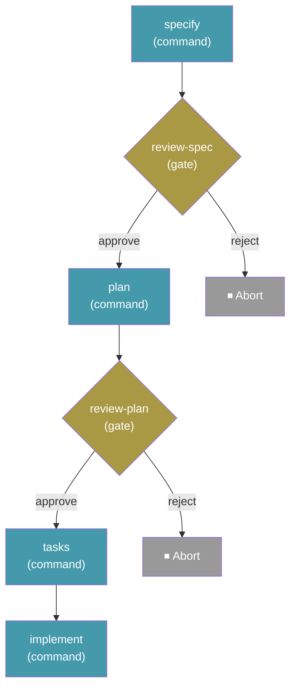

<a id="workflows"></a>

# Workflow

<!-- vi-banner:start -->

> [!NOTE]
> Đây là bản dịch tiếng Việt. Bản gốc: [English](../../reference/workflows.md). Thuật ngữ được thống nhất theo [Bảng thuật ngữ](../GLOSSARY.md); khi có khác biệt, bản tiếng Anh là bản chính thức.

<!-- vi-banner:end -->

Workflow tự động hóa các quy trình Phát triển hướng đặc tả nhiều bước — nối các command, prompt, step shell và điểm kiểm tra của con người thành chuỗi có thể lặp lại. Chúng hỗ trợ logic điều kiện, vòng lặp, fan-out/fan-in, và có thể tạm dừng rồi tiếp tục từ đúng điểm bị gián đoạn.

<a id="run-a-workflow"></a>

## Chạy workflow

```bash
specify workflow run <source>
```

| Tùy chọn | Mô tả |
| ------------------- | -------------------------------------------------------- |
| `-i` / `--input` | Truyền giá trị đầu vào dạng `key=value` (có thể lặp lại) |
| `--json` | Xuất kết quả lần chạy dưới dạng một đối tượng JSON duy nhất |

Chạy một workflow từ ID trong catalog, URL hoặc đường dẫn file cục bộ. Đầu vào do workflow khai báo có thể được cung cấp qua `--input`, nếu không sẽ được hỏi tương tác.

Ví dụ:

```bash
specify workflow run speckit -i spec="Build a kanban board with drag-and-drop task management"
```

Đầu vào khai báo `type: number` giữ nguyên chính xác giá trị số nguyên và chuỗi số nguyên, kể cả định danh 64-bit và timestamp nano giây lớn hơn `2**53`. Chuỗi số thập phân và số mũ tiếp tục dùng chuyển đổi dấu phẩy động; kết quả có giá trị nguyên được lưu dưới dạng số nguyên. Boolean, giá trị không phải số và số không hữu hạn bị từ chối.

Với `--json`, một đối tượng duy nhất máy đọc được sẽ được in ra thay vì văn bản định dạng (đầu ra mặc định không đổi khi bỏ cờ):

```bash
specify workflow run my-pipeline.yml --json
```

```json
{
  "run_id": "662bf791",
  "workflow_id": "build-and-review",
  "status": "paused",
  "current_step_id": "review",
  "current_step_index": 0
}
```

`workflow_id` là `workflow.id` được khai báo trong YAML, không phải tên file. Đối tượng được in chính xác như minh họa — định dạng đẹp với thụt lề hai dấu cách, trên stdout thuần không có markup Rich — nên luôn phân tích được. Khi workflow chạy với `--json`, mọi tiến trình mà một step sẽ in ra (ví dụ prompt của gate, hoặc đầu ra từ tiến trình con CLI của prompt step) được chuyển hướng sang stderr, nên stdout chỉ chứa đối tượng JSON. Đọc đối tượng từ stdout; để stderr gắn với terminal hoặc thu riêng.

Với các lần chạy `failed` và `aborted`, payload có trường `error` chứa thông báo lỗi của step kết thúc:

```json
{
  "run_id": "662bf791",
  "workflow_id": "build-and-review",
  "status": "failed",
  "current_step_id": "boom",
  "current_step_index": 0,
  "error": "Command exited with code 3"
}
```

Các lần chạy `completed` và `paused` không có trường `error`. Lỗi được lưu trong `state.json` của lần chạy, nên `specify workflow status <run_id> --json` hiển thị cùng thông báo đó về sau.

Lỗi nạp adapter trước khi tạo hoặc nạp trạng thái lần chạy dùng envelope lỗi trước khi chạy: lần chạy mới không có run ID, còn resume giữ run ID được cung cấp nhưng không có ngữ cảnh workflow hay step. Sau khi trạng thái lần chạy tồn tại, lỗi adapter từ việc nạp lại theo từng step hoặc import lười đã xác minh vẫn giữ các trường run, workflow và step hiện tại thực tế, giống như lỗi I/O khi thực thi. Nếu lưu trạng thái thất bại, trạng thái trên đĩa có thể vẫn phản ánh lần lưu thành công gần nhất thay vì lỗi I/O được báo.

> **Lưu ý:** Hầu hết lệnh workflow yêu cầu dự án đã được khởi tạo bằng `specify init`. Ngoại lệ là `specify workflow run <local-file.{yml,yaml}>`, có thể chạy bên ngoài dự án; khi đó, trạng thái lần chạy được lưu dưới `.specify/workflows/runs/<run_id>/` của thư mục hiện tại.

<a id="resume-a-workflow"></a>

## Tiếp tục workflow

```bash
specify workflow resume <run_id>
```

| Tùy chọn | Mô tả |
| ------------------- | -------------------------------------------------------- |
| `-i` / `--input` | Giá trị đầu vào cập nhật dạng `key=value` (có thể lặp lại) |
| `--json` | Xuất kết quả tiếp tục dưới dạng một đối tượng JSON duy nhất |

Tiếp tục một lần chạy workflow đang tạm dừng hoặc thất bại từ trạng thái thực thi đã lưu. Lần chạy `running` không thể tiếp tục. Resume phát lại công việc đã hoàn thành vào các ngữ cảnh biểu thức mà không chạy lại phần cài đặt của step, rồi tiếp tục tại lần xuất hiện chưa hoàn thành. Điều này cho phép lần chạy tiếp tục với thông tin chỉ có sau khi nó tạm dừng, hoặc với giá trị đã sửa sau một lỗi.

Các giá trị `--input` được cung cấp được gộp đè lên đầu vào gốc đã lưu của lần chạy và được kiểm tra lại theo kiểu đầu vào của workflow. Tên đầu vào gốc không xác định bị bỏ qua. Giá trị cập nhật chỉ ảnh hưởng tới công việc chưa hoàn thành; các step và lời gọi đã hoàn thành không được diễn giải lại hay lặp lại:

```bash
specify workflow resume <run_id> --input cmd="exit 0"
```

<a id="workflow-status"></a>

## Trạng thái workflow

```bash
specify workflow status [<run_id>]
```

| Tùy chọn | Mô tả |
| ------------------- | -------------------------------------------------------- |
| `--json` | Xuất trạng thái lần chạy (hoặc danh sách lần chạy) dưới dạng đối tượng JSON |

Hiển thị trạng thái của một lần chạy cụ thể, hoặc liệt kê mọi lần chạy nếu không có ID. Các trạng thái lần chạy: `created`, `running`, `completed`, `paused`, `failed`, `aborted`.

<a id="workflow-definition"></a>

## Định nghĩa workflow

```bash
specify workflow definition <run_id> --json
```

| Tùy chọn | Mô tả |
| -------- | ---------------------------------------------------------------- |
| `--json` | Bắt buộc. Xuất định nghĩa workflow của lần chạy dưới dạng đối tượng JSON |

Trả về định nghĩa workflow mà một lần chạy **đã bắt đầu với**, để integration có thể hiển thị lần chạy (ví dụ các gate được khai báo và thông báo của chúng) mà không lệch khỏi những gì engine thực sự thực thi. Nó chỉ đọc dữ liệu đã lưu của chính lần chạy và không bao giờ đọc workflow đã cài: sửa hoặc gỡ workflow đã cài không làm thay đổi đầu ra. Tiến trình runtime và gate đang hoạt động lấy từ [`specify workflow status --json`](#workflow-status).

Bỏ `--json` sẽ thoát với mã `2` và in thông báo cách dùng ra stderr; không có đầu ra stdout. Trình hiển thị dạng văn bản được hoãn lại, nên cấu trúc JSON dưới đây là hợp đồng duy nhất.

```json
{
  "run_id": "662bf791",
  "definition": {
    "schema_version": "1.0",
    "workflow": { "id": "spec-review", "name": "Spec review", "version": "1.0.0" },
    "steps": [
      { "id": "draft", "type": "command", "command": "speckit.specify" },
      { "id": "approve", "type": "gate", "message": "Review the specification." }
    ]
  },
  "workflow_scopes": []
}
```

- **`definition`** là workflow như được lưu cho lần chạy, nguyên văn và đã áp dụng overlay, nên nó phản ánh các step như đã thực thi. Mọi khóa đều được giữ nguyên (kể cả `requires`, `outputs` và khóa không xác định). Không có gì được thêm, đổi tên hay điền vào: một trường bị bỏ trống, như `options` của gate, nghĩa là giá trị mặc định của engine được áp dụng khi chạy. Biểu thức (`{{ ... }}`) không được đánh giá. Cấu trúc tuân theo [schema YAML của workflow](#workflow-yaml-schema), nên `schema_version` là phiên bản của giao diện này và thay đổi schema là thay đổi giao diện; vì `definition` được xuất như khi tác giả viết, `schema_version` bị bỏ trống mặc định là `"1.0"` và engine so sánh `str(schema_version)` (nên `schema_version: 1.0` không có dấu nháy trong YAML xuất hiện dưới dạng số JSON `1.0`). Các khóa có thể được thêm vào envelope phản hồi cấp cao nhất (`run_id`, `definition`, `workflow_scopes`) trong các phiên bản sau, nhưng các khóa envelope hiện có không bao giờ bị xóa hay đổi tên.
- **JSON thuần.** Các giá trị gốc YAML mà JSON không biểu diễn được, như ngày không có dấu nháy, xuất hiện dưới dạng chuỗi. Giá trị nhị phân (`!!binary`) không được xuất: mỗi giá trị xuất hiện dưới dạng placeholder `"<binary: N bytes>"`, còn bản thân giá trị vẫn nằm trong snapshot của lần chạy. Tập hợp (`!!set`) xuất hiện dưới dạng danh sách sắp theo dạng JSON của nó, nên đầu ra không phụ thuộc vào ngẫu nhiên hóa hash. Khóa mapping không phải chuỗi và số không hữu hạn cũng được chuyển thành chuỗi. Hai khóa mapping thu gọn về cùng một tên thuộc tính JSON (ví dụ `1` và `"1"`) sẽ khiến lệnh thất bại thay vì xuất JSON mất dữ liệu. JSON không thể chia sẻ tham chiếu, nên alias YAML (anchor) được tái sử dụng sẽ bị nhân bản; alias đệ quy, hoặc đồ thị alias không đệ quy mở rộng vượt quá ngân sách cố định về số node hoặc kích thước đầu ra, sẽ thất bại thay vì tiêu tốn CPU, bộ nhớ và stdout không giới hạn. Ngân sách áp dụng riêng cho từng định nghĩa (gốc và mỗi mục trong `workflow_scopes`), nên một lần chạy có nhiều lời gọi workflow đã gắn không bị từ chối vì tổng kích thước. Một giới hạn riêng, lớn hơn nhiều (32 MiB) áp cho toàn bộ phản hồi, nên vòng lặp hoặc fan-out lặp lại một định nghĩa lớn sẽ thất bại thay vì nhân bản nó. Khóa mapping không phải chuỗi dài hơn 256 ký tự sau khi chuyển thành chuỗi bị từ chối vì cùng lý do.
- **`workflow_scopes`** (luôn có) chứa định nghĩa đã đóng băng của mọi [lời gọi workflow](#workflow-composition) đã được tới, theo thứ tự thực thi. Mỗi mục là `{ "scope_path", "workflow_id", "definition" }`, với `scope_path` và `workflow_id` giống hệt giá trị trong `status --json`. Call step bên trong `definition` giữ nguyên như khi viết; workflow được gọi không bao giờ được mở rộng tại chỗ. Lời gọi chưa được tới, hoặc có đích không phân giải được, sẽ không có mục, và định nghĩa của nó không bao giờ được đọc từ workflow đã cài. Danh sách tăng dần khi các lời gọi được tới, và lời gọi bên trong vòng lặp hoặc fan-out có một mục cho mỗi lần lặp hoặc mỗi item.
- **Không bao gồm: step được sinh động.** Đầu ra chứa định nghĩa gốc do tác giả viết và các định nghĩa đã đóng băng của lời gọi workflow đã gắn. Các step mà một loại step tùy chỉnh sinh ra khi chạy qua `StepResult.next_steps` được lưu trong trạng thái thực thi của lần chạy nhưng không được xuất, nên gate được tạo theo cách đó không có định nghĩa trong đầu ra này. Các step có sẵn `if`, `switch`, `while`, `do-while` và `fan-out` lấy step từ định nghĩa do tác giả viết và được bao gồm.
- **`scope_path`** là danh sách chuỗi tính từ gốc: `id` do tác giả viết của mọi step bao quanh (`step-<index>` với step không có `id`). Các container như `if`, `switch`, vòng lặp và fan-out là phần tử; mỗi lần lặp và mỗi item fan-out thêm chỉ số của nó dưới dạng chuỗi, kể cả cái đầu tiên (`["loop", "0", "call"]`). Ở đây `workflow_scopes` luôn có, còn `status --json` chỉ có nó khi lần chạy có lời gọi workflow.

<a id="matching-a-gate-to-its-definition"></a>

### Đối chiếu một gate với định nghĩa của nó

`status --json` báo gate đang hoạt động dưới dạng `gate.step_id` và `gate.scope_path`. Để tìm định nghĩa của gate:

1. Coi `gate.scope_path` là `[]` khi nó bị thiếu: `status --json` bỏ nó với gate nằm trực tiếp trong workflow gốc. Sau đó lấy mục `workflow_scopes` có `scope_path` dài nhất là tiền tố của `gate.scope_path`. Nếu không có, dùng `definition` gốc. Không yêu cầu khớp chính xác: `gate.scope_path` liệt kê mọi step bao quanh, gồm `if`, `switch`, vòng lặp và container fan-out, còn `scope_path` của một mục kết thúc tại call step. Một gate trong `if` tên `wrap` bên trong workflow được gọi bởi `call`, bản thân nằm trong `if` tên `route`, sẽ báo `["route", "call", "wrap"]`, và mục của nó có `["route", "call"]`.
2. Trong định nghĩa đó, tìm step có `id` bằng step ID do tác giả viết. Trong các lần lặp sau và các item fan-out, `step_id` được định danh đầy đủ dạng `<container>:<id>:<n>` (ví dụ `fan:g:0`); ID do tác giả viết là đoạn áp chót khi tách theo `:`, vì `:` không được phép trong step ID do tác giả viết. Step ID là duy nhất trong một định nghĩa, ngoại trừ giữa các template fan-out vốn có không gian tên ID riêng: một step gốc và một step trong template fan-out có thể trùng ID. Nếu `gate.scope_path` đi qua một step fan-out, chỉ tìm bên trong template `step` của step đó; nếu không, bỏ qua các template fan-out. Ví dụ, có cả shell `g` ở gốc và gate `g` trong template của fan-out `fan`, thì `fan:g:0` với `scope_path` `["fan", "0"]` là gate của template, không phải shell ở gốc.

Gate được một step tùy chỉnh sinh ra khi chạy không có định nghĩa để đối chiếu; xem ghi chú về step được sinh động ở trên.

`status --json` không báo trạng thái từng step cho các step bên trong workflow được gọi.

<a id="errors"></a>

### Lỗi

Khi thất bại, lệnh ghi một đối tượng `{"error": "<message>"}` duy nhất ra stderr, để stdout rỗng và thoát với mã `1`: không phải dự án Spec Kit, `SPECIFY_INIT_DIR` không hợp lệ, lưu trữ workflow không an toàn (kể cả symlink), run ID không hợp lệ hoặc không xác định, trạng thái lần chạy không đọc được hoặc lồng quá sâu, lần chạy không có định nghĩa đã lưu (ví dụ lần chạy được tạo trước khi định nghĩa được lưu), định nghĩa hoặc trạng thái thực thi bị hỏng, định nghĩa có khóa mapping thu gọn về cùng tên thuộc tính JSON, và định nghĩa có alias YAML đệ quy hoặc quá lớn để mở rộng. Lỗi cách dùng với `--json` cũng dùng hợp đồng lỗi JSON này và thoát với mã `2`.

<a id="list-installed-workflows"></a>

## Liệt kê workflow đã cài

```bash
specify workflow list
```

Liệt kê các workflow đã cài trong dự án hiện tại.

<a id="install-a-workflow"></a>

## Cài workflow

```bash
specify workflow add <source>
```

| Tùy chọn | Mô tả |
| --------------- | ------------------------------------------------------ |
| `--dev` | Cài từ file YAML cục bộ, thư mục package hoặc archive |
| `--from <url>` | Cài từ URL tùy chỉnh (`<source>` là ID workflow mong đợi) |
| `--version <version>` | Cài chính xác một bản phát hành được công bố trong catalog (`<source>` phải là ID workflow) |

Cài workflow từ catalog, URL HTTPS, file YAML cục bộ, thư mục chứa `workflow.yml`, hoặc archive `.zip`, `.tar.gz` hay `.tgz`. Archive có thể chứa `workflow.yml` ở gốc hoặc bên trong một thư mục cấp cao nhất.

Cài từ thư mục và archive giữ nguyên toàn bộ package workflow, gồm script và các file đi kèm khác. Archive ZIP, `.tar.gz` và `.tgz` tuân theo cùng hành vi kiểm tra và cài đặt.

Mục catalog giữ `version`, `url`, `sha256` tùy chọn và `requires` tùy chọn của bản phát hành hiện tại ở cấp cao nhất. Mapping `releases` tùy chọn công bố các phiên bản lịch sử mà không thay đổi những gì `add`, `search`, `info` hay `update` không chỉ định phiên bản sẽ chọn:

```json
{
  "id": "example",
  "version": "2.0.0",
  "url": "https://example.com/example-2.0.0.zip",
  "releases": {
    "1.0.0": {
      "url": "https://example.com/example-1.0.0.zip",
      "sha256": "aaaaaaaaaaaaaaaaaaaaaaaaaaaaaaaaaaaaaaaaaaaaaaaaaaaaaaaaaaaaaaaa",
      "requires": {"speckit_version": ">=1.0.0"}
    }
  }
}
```

Mỗi bản phát hành lịch sử cần URL và digest SHA-256 riêng; `requires` là tùy chọn và, khi có, phải khớp với định nghĩa workflow đã tải. Phiên bản được công bố dùng định dạng phiên bản `X.Y.Z` của định nghĩa workflow; `--version` cũng chấp nhận cách viết tương đương như `v1.0` khi chọn bản phát hành `1.0.0` được công bố. Phiên bản được yêu cầu phải tồn tại trong catalog có ưu tiên cao nhất cung cấp workflow đó. Phiên bản bị thiếu không chuyển sang nguồn khác, và không thể cài từ catalog chỉ tìm kiếm. ID, phiên bản và digest đã khai báo của workflow được tải về được xác minh trước khi cài. `--version` không áp dụng cho đường dẫn cục bộ, URL trực tiếp hay cài đặt bằng `--from`.

<a id="workflow-overlays"></a>

## Overlay của workflow

Overlay của workflow cho phép một dự án mở rộng hoặc ghi đè workflow đã cài mà không sửa `workflow.yml` đã cài. Nhờ vậy các tùy biến cục bộ được giữ an toàn qua các lần nâng cấp bằng `specify bundle update` hoặc `specify workflow add`.

Khi `specify workflow run <workflow-id>` nạp một workflow, engine kết hợp workflow gốc với mọi overlay đang bật cho workflow id đó. Kết quả được kiểm tra như mọi định nghĩa workflow khác.

<a id="how-overlays-work"></a>

### Cách overlay hoạt động

Overlay là một file YAML khai báo tập thao tác chỉnh sửa trên danh sách step của một workflow gốc. Overlay dùng quy tắc ưu tiên số thấp thắng: số priority cao hơn được áp dụng trước và số thấp hơn được áp dụng sau cùng. Overlay cùng priority được áp dụng theo bảng chữ cái của ID, ID cuối cùng thắng khi xung đột.

File overlay của dự án nằm tại:

| Vị trí | Mục đích |
| --- | --- |
| `.specify/workflows/overlays/<id>/*.yml` | Tùy biến cục bộ của dự án |

<a id="overlay-file-format"></a>

### Định dạng file overlay

Định dạng chỉnh sửa khuyến nghị dùng tên thao tác làm khóa và step id làm anchor làm giá trị:

```yaml
id: "my-overlay"
extends: "speckit"
priority: 10
enabled: true
edits:
  - insert_after: implement
    step:
      id: run-lint
      type: shell
      run: "ruff check src/"

  - replace: review-spec
    step:
      id: review-spec
      type: gate
      message: "Review the generated spec (overlay override)."
      options: [approve, reject]
      on_reject: abort
```

Dạng tường minh cũng được hỗ trợ:

```yaml
edits:
  - operation: insert_after
    anchor: implement
    step:
      id: run-lint
      type: shell
      run: "ruff check src/"
```

<a id="fields"></a>

#### Các trường

| Trường | Bắt buộc | Mô tả |
| --- | --- | --- |
| `id` | có | Định danh của overlay này. Dùng trong các lệnh `specify workflow overlay *`. Chỉ được gồm chữ thường, chữ số và dấu gạch ngang; không có dấu chấm, gạch dưới, dấu phân cách đường dẫn hay `overlays`. |
| `extends` | có | Workflow id mà overlay này áp dụng. Dùng cùng định dạng safe-id như `id`; `overlays`, `runs` và `steps` được dành riêng. |
| `priority` | không | Số nguyên; mặc định là `10`. Giá trị thấp hơn có độ ưu tiên cao hơn và thắng khi xung đột. Giá trị bị thiếu hoặc không hợp lệ quay về `10`. |
| `enabled` | không | Boolean. Mặc định là `true`. Overlay bị tắt sẽ bị bỏ qua. |
| `edits` | có | Danh sách thao tác chỉnh sửa không rỗng. |

<a id="edit-operations"></a>

#### Thao tác chỉnh sửa

| Thao tác | Cần `step` | Tác dụng |
| --- | --- | --- |
| `insert_after` | có | Chèn `step` ngay sau step anchor. |
| `insert_before` | có | Chèn `step` ngay trước step anchor. |
| `replace` | có | Thay step anchor bằng `step`. |
| `remove` | không | Xóa step anchor khỏi danh sách. |

`anchor` là `id` của một step trong workflow gốc. Anchor được phân giải đệ quy bên trong các khối `then`, `else`, `steps`, `cases.*` và `default`, nên cũng có thể nhắm tới các step lồng trong workflow gốc. Template fan-out (`step` bên trong step `fan-out`) **không** phải anchor hợp lệ.

Step id không được chứa `:` — ký tự này dành riêng cho các id lồng nhau do engine sinh ra.

<a id="overlay-cli-commands"></a>

### Lệnh CLI cho overlay

<a id="add-a-project-overlay"></a>

#### Thêm overlay cho dự án

```bash
specify workflow overlay add <path-to-overlay.yml> --priority <n>
```

Kiểm tra file overlay và sao chép nó tới `.specify/workflows/overlays/<extends>/<id>.yml`. `--priority` mặc định là `10` và ghi đè trường `priority` trong file.

<a id="list-overlays"></a>

#### Liệt kê overlay

```bash
specify workflow overlay list <workflow-id>
```

Hiển thị mọi overlay của workflow, sắp theo thứ tự ưu tiên của bộ phân giải. Overlay bị tắt được đánh dấu là disabled trong danh sách và bị bỏ qua khi phân giải workflow.

<a id="change-priority"></a>

#### Đổi độ ưu tiên

```bash
specify workflow overlay set-priority <workflow-id> <overlay-id> <n>
```

<a id="enable-or-disable"></a>

#### Bật hoặc tắt

```bash
specify workflow overlay disable <workflow-id> <overlay-id>
specify workflow overlay enable <workflow-id> <overlay-id>
```

<a id="remove"></a>

#### Gỡ

```bash
specify workflow overlay remove <workflow-id> <overlay-id>
```

Xóa file overlay của dự án.

<a id="inspect-the-composed-workflow"></a>

#### Kiểm tra workflow đã kết hợp

```bash
specify workflow resolve <workflow-id>
```

In chồng lớp (gốc + overlay) và nguồn gốc của từng step sau khi kết hợp. Hữu ích khi gỡ lỗi xem overlay nào đã đóng góp hoặc ghi đè một step.

<a id="example-adding-automated-linting-after-implementation"></a>

### Ví dụ: Thêm linting tự động sau bước implement

Với workflow `speckit` có sẵn, hãy tạo `project-overlay.yml`:

```yaml
id: "add-lint"
extends: "speckit"
priority: 10
edits:
  - insert_after: implement
    step:
      id: run-lint
      type: shell
      run: "ruff check src/"
```

Cài nó:

```bash
specify workflow overlay add project-overlay.yml --priority 10
```

Chạy workflow:

```bash
specify workflow run speckit -i spec="Build a kanban board"
```

Workflow đã kết hợp giờ sẽ chạy toàn bộ chu trình SDD và tự động thực thi `ruff check src/` sau step `implement`.

<a id="example-replacing-a-gate"></a>

### Ví dụ: Thay thế một gate

```yaml
id: "skip-plan-review"
extends: "speckit"
priority: 5
edits:
  - replace: review-plan
    step:
      id: review-plan
      type: command
      command: speckit.plan
      input:
        args: "{{ inputs.spec }}"
```

Giá trị priority thấp hơn có độ ưu tiên cao hơn. Đổi overlay này thành `priority: 5` nếu nó phải thắng khi xung đột với overlay `add-lint` ở trên. Nó thay gate `review-plan` bằng một command không tương tác.

<a id="workflow-slots-upstream-extension-points"></a>

### Slot của workflow (điểm mở rộng từ upstream)

Tác giả workflow có thể khai báo một slot workflow có tên, không làm gì, bằng `type: slot`:

```yaml
- id: post-implement
  type: slot
  name: "Post-implementation checks"
```

`id` của step là anchor overlay duy nhất; `name` là nhãn dễ đọc bắt buộc không rỗng và chỉ để hiển thị. Slot chưa được lấp hoàn tất dưới dạng step `skipped` với `output: {slot: <name>}`, nên các step tiếp theo vẫn chạy bình thường.

Lấp slot bằng một chỉnh sửa overlay `replace` hợp lệ theo schema, neo vào `id` của step chứ không phải `name`:

```yaml
id: fill-post-implement
extends: my-workflow
edits:
  - replace: post-implement
    step:
      id: post-implement
      type: shell
      run: "echo Run project-specific checks"
```

Dùng lại `id` của slot khi các biểu thức sau hoặc `fan-in.wait_for` tham chiếu tới nó. Bản thay thế cũng phải giữ mọi khóa đầu ra mà các step sau dùng: slot workflow chưa được lấp chỉ cung cấp `steps.<id>.output.slot`. Step slot không được hỗ trợ bên trong template `fan-out.step` vì template được nhân lên khi chạy không thể làm anchor overlay.

<a id="interaction-with-bundles-and-updates"></a>

### Tương tác với bundle và cập nhật

`specify workflow add <local-directory>` cài toàn bộ package workflow cục bộ vào `.specify/workflows/<id>/`. Cài từ archive giữ nguyên cùng nội dung package.

Khi một workflow đã cài được làm mới hoặc cài lại, overlay của dự án trong `.specify/workflows/overlays/<id>/` được giữ nguyên vì chúng nằm ngoài thư mục workflow đã cài.

<a id="limitations"></a>

### Hạn chế

- Overlay chỉ thao tác trên danh sách step. Chúng không thể thay đổi metadata của workflow (tên, mô tả, đầu vào, `requires`) hay logic biểu thức.
- Không thể dùng template fan-out làm anchor.
- Overlay nhắm tới step id không tồn tại trong workflow gốc sẽ gây lỗi kiểm tra khi workflow được phân giải.
- Overlay không thể nhắm tới step do overlay khác thêm vào.
- Overlay không thể thêm đầu vào mới hay thay đổi schema đầu vào của workflow gốc.

<a id="update-workflows"></a>

## Cập nhật workflow

```bash
specify workflow update [workflow_id]
```

Cập nhật một workflow đã cài từ catalog — hoặc tất cả khi không có ID — lên phiên bản mới nhất trong catalog. Hỏi xác nhận và giữ bản đã cài nếu tải về hoặc kiểm tra thất bại.

<a id="enable-or-disable-a-workflow"></a>

## Bật hoặc tắt workflow

```bash
specify workflow enable <workflow_id>
specify workflow disable <workflow_id>
```

Workflow bị tắt vẫn được cài và liệt kê (đánh dấu `[disabled]`) nhưng từ chối chạy cho đến khi được bật lại.

<a id="remove-a-workflow"></a>

## Gỡ workflow

```bash
specify workflow remove <workflow_id>
```

Gỡ một workflow đã cài khỏi dự án.

<a id="search-available-workflows"></a>

## Tìm workflow có sẵn

```bash
specify workflow search [query]
```

| Tùy chọn | Mô tả |
| ---------- | ----------------- |
| `--tag` | Lọc theo tag |
| `--author` | Lọc theo tác giả |

Tìm trong mọi catalog đang hoạt động các workflow khớp truy vấn.

<a id="workflow-info"></a>

## Thông tin workflow

```bash
specify workflow info <workflow_id>
specify workflow info <workflow_id> --versions
```

Hiển thị thông tin chi tiết về một workflow, gồm step, đầu vào và yêu cầu của nó. `--versions` liệt kê phiên bản hiện tại trong catalog, theo sau là các phiên bản lịch sử được công bố, và cho biết catalog thắng cài được hay chỉ tìm kiếm (không cài được). Nó cũng hoạt động khi máy cục bộ đã cài một phiên bản khác.

<a id="catalog-management"></a>

## Quản lý catalog

Catalog workflow kiểm soát nơi `search` và `add` tìm workflow. Các catalog được kiểm tra theo thứ tự ưu tiên.

Catalog workflow và catalog step lưu cache JSON đã tải và metadata về độ mới trong một giờ, lần lượt tại `.specify/workflows/.cache/` và `.specify/workflows/steps/.cache/`. I/O của cache không đi theo thành phần thư mục hay file cache là symlink. Thao tác ghi thay thế file cache một cách nguyên tử thay vì cắt bớt đích mà chúng trỏ tới, nên một symlink file cache có sẵn có thể bị thay thế mà không làm thay đổi đích của nó. Nếu không thể ghi cache an toàn, một cảnh báo được ghi log và việc tìm kiếm tiếp tục với catalog đã tải.

> **File `.specify/workflow-catalogs.yml` của một dự án có thể trỏ `add` và `search` tới một catalog bạn không chọn.** Trước khi chạy workflow từ một dự án lạ, hãy chạy `specify workflow catalog list` (và `specify workflow step catalog list` cho các catalog step mà step của nó có thể kéo về) — việc một dự án cung cấp cấu hình đó không phải bằng chứng các workflow hay step của nó đã được kiểm định. Maintainer không kiểm định code workflow; hãy tự review cả `run` và `env` trong các shell step của nó, kể cả step strict (xem [Review việc thực thi shell](#reviewing-shell-execution) và [Ai duy trì các workflow?](#who-maintains-workflows)).

<a id="list-catalogs"></a>

### Liệt kê catalog

```bash
specify workflow catalog list
```

Hiển thị mọi nguồn catalog đang hoạt động.

<a id="add-a-catalog"></a>

### Thêm catalog

```bash
specify workflow catalog add <url>
```

| Tùy chọn | Mô tả |
| --------------- | -------------------------------- |
| `--name <name>` | Tên tùy chọn cho catalog |

Thêm một URL catalog tùy chỉnh vào `.specify/workflow-catalogs.yml` của dự án.

Thêm lại cùng URL catalog workflow hoặc step với cùng tên sẽ thành công mà không thay đổi cấu hình; tên khác sẽ bị từ chối.

<a id="remove-a-catalog"></a>

### Gỡ catalog

```bash
specify workflow catalog remove <index>
specify workflow step catalog remove <index>
```

Gỡ một catalog của dự án theo chỉ số của nó trong `catalog list` tương ứng, vốn được sắp theo độ ưu tiên. Không thể gỡ theo cách này các nguồn do `SPECKIT_WORKFLOW_CATALOG_URL` hoặc `SPECKIT_STEP_CATALOG_URL` cung cấp; hãy bỏ đặt biến đó để quản lý nguồn của dự án.

<a id="catalog-resolution-order"></a>

### Thứ tự phân giải catalog

Catalog được phân giải theo thứ tự sau (mục khớp đầu tiên thắng):

1. **Biến môi trường** — `SPECKIT_WORKFLOW_CATALOG_URL` ghi đè mọi catalog
2. **Cấu hình dự án** — `.specify/workflow-catalogs.yml`
3. **Cấu hình người dùng** — `~/.specify/workflow-catalogs.yml`
4. **Mặc định có sẵn** — catalog chính thức + catalog cộng đồng

<a id="workflow-yaml-schema"></a>

## Schema YAML của workflow

Workflow được định nghĩa trong file YAML. Đây là workflow **Full SDD Cycle** có sẵn đi kèm Spec Kit:

```yaml
schema_version: "1.0"
workflow:
  id: "speckit"
  name: "Full SDD Cycle"
  version: "1.0.1"
  author: "GitHub"
  description: "Runs specify → plan → tasks → implement with review gates"

requires:
  speckit_version: ">=0.8.5"
  integrations:
    any:
      - "alquimia"
      - "claude"
      - "copilot"
      - "gemini"
      - "opencode"

inputs:
  spec:
    type: string
    required: true
    prompt: "Describe what you want to build"
  integration:
    type: string
    default: "auto"
    prompt: "Integration to use (e.g. claude, copilot, gemini; 'auto' uses the project's initialized integration)"

steps:
  - id: specify
    command: speckit.specify
    integration: "{{ inputs.integration }}"
    input:
      args: "{{ inputs.spec }}"

  - id: review-spec
    type: gate
    message: "Review the generated spec before planning."
    options: [approve, reject]
    on_reject: abort

  - id: plan
    command: speckit.plan
    integration: "{{ inputs.integration }}"
    input:
      args: "{{ inputs.spec }}"

  - id: review-plan
    type: gate
    message: "Review the plan before generating tasks."
    options: [approve, reject]
    on_reject: abort

  - id: tasks
    command: speckit.tasks
    integration: "{{ inputs.integration }}"
    input:
      args: "{{ inputs.spec }}"

  - id: implement
    command: speckit.implement
    integration: "{{ inputs.integration }}"
    input:
      args: "{{ inputs.spec }}"
```

Nó tạo ra luồng thực thi sau:



Chạy nó bằng:

```bash
specify workflow run speckit -i spec="Build a kanban board with drag-and-drop task management"
```

<a id="step-types"></a>

## Các loại step

| Kiểu | Mục đích |
| ------------ | ------------------------------------------------ |
| `command` | Gọi một lệnh Spec Kit (ví dụ `speckit.plan`) |
| `prompt` | Gửi một prompt tùy ý tới agent lập trình AI |
| `shell` | Thực thi lệnh shell và thu đầu ra |
| `github` | Thêm một nhãn chỉ định rõ cho issue hoặc pull request |
| `init` | Khởi tạo dự án (như `specify init`) |
| `slot` | Slot workflow có tên; bị bỏ qua khi chưa được lấp |
| `gate` | Tạm dừng để con người phê duyệt trước khi tiếp tục |
| `if` | Rẽ nhánh điều kiện (then/else) |
| `switch` | Điều phối nhiều nhánh theo một biểu thức |
| `while` | Lặp khi điều kiện còn đúng |
| `do-while` | Thực thi ít nhất một lần, rồi lặp theo điều kiện |
| `fan-out` | Điều phối một step cho mỗi item trong danh sách |
| `fan-in` | Tổng hợp kết quả từ một step fan-out |
| `workflow` | Gọi một workflow đã cài với đầu vào riêng và đầu ra đã khai báo |

<a id="workflow-composition"></a>

### Kết hợp workflow

Step `workflow` thực thi một workflow đã cài và đang bật trong dự án hiện tại như một phạm vi riêng của cùng lần chạy. Đích có thể là ID literal hoặc biểu thức; chuỗi sau khi phân giải phải khớp chính xác ID, kể cả chữ hoa/thường và khoảng trắng.

```yaml
inputs:
  target: {type: string, required: true}
  report: {type: string, required: true}
steps:
  - id: investigate
    type: workflow
    workflow: "{{ inputs.target }}"
    input:
      report: "{{ inputs.report }}"
```

Workflow được gọi chỉ thấy các đầu vào đã khai báo được truyền qua `input` và kết quả step của chính nó. Nó không kế thừa `inputs`, kết quả step, giá trị `item`/`fan_in` của fan-out hay giá trị mặc định workflow của nơi gọi. Tên đầu vào không xác định, giá trị bắt buộc bị thiếu và kiểu/enum không hợp lệ sẽ làm lời gọi thất bại. Giá trị mặc định có sẵn của workflow con và cách phân giải `integration: auto` vẫn được áp dụng. Giá trị chỉ được trả ngược qua các khai báo tường minh:

```yaml
outputs:
  report:
    value: "{{ steps.analyze.output.stdout }}"
```

Nơi gọi đọc `{{ steps.investigate.output.report }}`. Đầu ra gồm `workflow` và `status`; khi thất bại có `error` nếu thao tác thất bại có báo lỗi, và khi abort có `aborted: true`. Các tên này cùng `integration`, `model`, `options` và `input` được dành riêng. Giá trị trả về phải an toàn với JSON. Đầu vào riêng, bản ghi step và log không thuộc giá trị trả về. Không có lần chạy con riêng nào được tạo.

`continue_on_error: true` trên lời gọi workflow xử lý lỗi do workflow con trả về và lỗi hợp đồng tại ranh giới lời gọi, như đích không có sẵn, đầu vào ánh xạ không hợp lệ, vòng lặp gọi, giới hạn độ sâu hoặc đầu ra khai báo không hợp lệ. Nó không bắt ngoại lệ của step, lỗi biểu thức (kể cả lỗi `from_json` trong `input:` hoặc `outputs:`), gián đoạn hay lỗi checkpoint; những lỗi đó lan truyền đúng như ở gốc. Phần cài đặt step không có sẵn là lỗi kết thúc tại nơi step xuất hiện; tại lời gọi workflow, đó là lỗi con được báo, dù được phát hiện khi gắn đích hay về sau. Tạm dừng và abort tường minh luôn dừng việc thực thi.

Cho phép kết hợp lồng nhau, nhưng workflow ID lặp lại trên đường gọi đang hoạt động là vòng lặp gọi. Cho phép cấu trúc hình thoi. Độ sâu lồng tối đa là 16, với gốc ở độ sâu 0.

<a id="calling-a-child-gate"></a>

### Gọi một gate của workflow con

Chỉ đầu vào được khai báo ở gốc mới có thể truyền cho `workflow resume --input`. Ánh xạ một đầu vào gốc qua từng ranh giới workflow khi gate của workflow con dùng nó làm `verdict_input`:

```yaml
# Parent workflow
inputs:
  approval:
    type: string
    default: ""
steps:
  - id: review-release
    type: workflow
    workflow: release-notes
    input:
      approval: "{{ inputs.approval }}"
```

```yaml
# Installed release-notes workflow
inputs:
  approval:
    type: string
    default: ""
steps:
  - id: review
    type: gate
    message: "Approve the release notes?"
    options: [approve, reject]
    verdict_input: approval
```

Lần chạy đầu tiên tạm dừng nếu `approval` rỗng. Trạng thái có cấu trúc của nó xác định gate lồng nhau và lời gọi bao quanh bằng `gate.scope_path`. Tiếp tục lần chạy gốc, không phải workflow con, để chạy tiếp:

```bash
specify workflow status <run-id> --json
specify workflow resume <run-id> --input approval=approve
```

Gate có `verdict_input` không được hỗ trợ bên trong item fan-out, kể cả qua một hay nhiều lời gọi workflow. Điều kiện runtime `inside_fan_out` được giữ qua các ranh giới workflow.

<a id="defaults-and-errors-at-the-call-boundary"></a>

### Giá trị mặc định và lỗi tại ranh giới lời gọi

Giá trị mặc định `integration`, `model` và `options` của workflow cha chỉ áp dụng cho step trong workflow cha. Workflow con dùng giá trị mặc định riêng hoặc phân giải tự động. Để một giá trị dùng chung cho cả hai, hãy khai báo nó là đầu vào của workflow con và ánh xạ tường minh. Kết quả lời gọi cố ý có trường `input` rỗng và không để lộ đầu vào riêng, bản ghi step hay log của workflow con.

Lỗi hợp đồng khi gắn ban đầu hoặc khi hoàn tất đầu ra có thể được xử lý bằng `continue_on_error`. Lỗi khi gắn lại một lời gọi chưa hoàn thành trong `workflow resume --input` thì khác: nó lan truyền. Với lời gọi đã gắn trước đó, resume bỏ `result`, `outcome` và `error` cũ nhưng giữ việc gắn và cây con của workflow con, nên có thể thử lại với đầu vào gốc đã sửa. Lời gọi gắn ban đầu thất bại sẽ quay về `ready` và thử lại việc phân giải đích và gắn.

<a id="execution-identity-and-resume"></a>

### Định danh thực thi và resume

Mỗi lần xuất hiện của step sở hữu một bản ghi trong cây thực thi được lưu. Step ID do tác giả viết là alias biểu thức cục bộ, không phải ID thực thi toàn cục. Các item fan-out có ngữ cảnh alias độc lập và kết quả item có thứ tự. Báo cáo công khai dùng ID lần xuất hiện được định danh đầy đủ khi cần, ví dụ `fan:template:0` cho item fan-out và `loop:step:1` cho một lần lặp sau. ID định danh đầy đủ không phải tên trong biểu thức. Alias của item fan-out chỉ dùng để báo cáo: `wait_for` của `fan-in` tham chiếu các step ID đã khai báo, đặc biệt là `id` của chính step fan-out, có các kết quả item theo thứ tự tại `steps.<fan-out-id>.output.results`.

> **Ghi chú chuyển đổi:** đầu ra của fan-out không còn chứa `step_template`. `steps.<fan-out-id>.output` và mục của fan-out trong `output.results` của `fan-in` chứa `items`, `max_concurrency`, `item_count` và `results`; template chỉ được giữ trong cây thực thi riêng dùng để chạy các item. Biểu thức như `{{ steps.<fan-out-id>.output.step_template }}` giờ phân giải thành rỗng. Thay vào đó, hãy đọc template từ `step` của fan-out trong định nghĩa workflow.

Lần chạy mới lưu các nhánh được chọn, phần mở rộng động của step tùy chỉnh, các lần lặp và các item fan-out. Resume giữ công việc đã hoàn thành mà không đánh giá lại các nhánh đã chọn. Đích workflow và định nghĩa đã phân giải overlay vẫn được gắn ngay cả khi bản cài đặt thay đổi. Lời gọi chưa gắn vẫn kiểm tra đích đã được cài và đang bật khi việc thực thi tới nó.

Resume thông thường giữ đầu vào đã gắn. `--input` tường minh gắn lại các lời gọi đã tới nhưng chưa hoàn thành qua ánh xạ ban đầu của chúng: giá trị mới được ánh xạ ghi đè việc gắn trước đó, còn giá trị không được ánh xạ lại giữ giá trị đã gắn. Lời gọi đã hoàn thành giữ kết quả của chúng. Đánh giá đầu ra thất bại chỉ thử lại bước hoàn tất, không lặp lại các lệnh con đã hoàn thành.

Snapshot được lưu dưới dạng chuỗi YAML bên trong cây thực thi JSON riêng, giữ nguyên kiểu scalar của YAML. Đầu vào và kết quả vẫn là giá trị JSON. Snapshot đóng băng định nghĩa workflow và các phần mở rộng, không đóng băng file dưới `context.workflow_dir` hay phần cài đặt step; tài nguyên bị thiếu vẫn có thể gây lỗi step thông thường. Lần chạy kiểu cũ không có cây sẽ vào qua chỉ số gốc đã lưu, rồi dùng resume dựa trên cây. Resume chỉ khả dụng cho lần chạy ở trạng thái `paused` hoặc `failed`.

`current_step_index` là chỉ số trong chuỗi gốc; `current_step_id` là góc nhìn tương thích theo ID lần xuất hiện, được cập nhật khi các step được vào. Nó không phải tập chính xác các step đang hoạt động: trong fan-out song song, nó có thể chỉ tới một item đã hoàn thành. Giá trị định danh đầy đủ gồm `fan:item:0` cho item fan-out và `loop:body:1` cho một lần lặp sau. Bên trong lời gọi workflow, ID là tương đối với workflow được gọi. Đầu ra run/status có cấu trúc có tóm tắt `workflow_scopes` khi có lời gọi và báo gate lồng nhau đang hoạt động cùng `scope_path` của nó. Sự kiện log riêng thêm `workflow_id` và `execution_path` vào `step_id` định danh đầy đủ. Step phát sự kiện hoàn thành sau checkpoint của nó; container phát trước các step con, còn các lần xuất hiện đã hoàn thành được phát lại không phát sự kiện step nào.

### Shell step

`type: shell` thực thi `run` qua shell của nền tảng, vẫn hỗ trợ pipe, chuyển hướng và nhiều lệnh. Đặt `strict: true` để từ chối dấu biểu thức `{{` ở bất cứ đâu trong `run`, kể cả bên trong dấu nháy. Điều này được kiểm tra cả khi kiểm tra hợp lệ và ngay trước khi thực thi. `strict` phải là boolean; bỏ trống hoặc `false` giữ hành vi nội suy thô hiện có.

Dùng mapping `env` để gắn giá trị động mà không chèn chúng vào mã nguồn shell. Ví dụ, trên POSIX:

```yaml
- id: display-result
  type: shell
  strict: true
  env:
    RESULT: "{{ steps.plan.output.stdout }}"
  run: 'printf "%s\n" "$RESULT"'
```

Với script đa nền tảng, hãy đọc biến môi trường ngay trong chương trình, như `os.environ["RESULT"]` trong Python. Xem [Biến môi trường của shell step](#shell-step-environment-variables) để biết hợp đồng gắn và [Nội suy và an toàn shell](#interpolation-and-shell-safety) để biết ranh giới tin cậy còn lại.

> **Lưu ý bảo mật:** step `shell` chạy lệnh cục bộ với quyền **của bạn**. Không có sandbox năng lực — `requires` là khối điều kiện tiên quyết mang tính khuyến nghị (phiên bản spec-kit, integration), không phải cổng kiểm soát khi chạy, nên nó **không** giới hạn những gì step có thể làm. Đặc biệt, không có cổng năng lực `requires.permissions`: nó bị từ chối khi kiểm tra chính vì nó ngụ ý một sandbox không tồn tại. Hãy review mọi workflow từ catalog hoặc được tải về trước khi chạy, và dùng step `gate` để yêu cầu phê duyệt tường minh trước các lệnh shell nhạy cảm hoặc có tính phá hủy.

### GitHub step

`type: github` dùng CLI `gh` đã cài và phiên xác thực đang hoạt động của nó. Chỉ định repository GitHub dạng `owner/repo`; không cần Git remote hay bản checkout mã nguồn. Request được gửi tới endpoint REST `api.github.com` của GitHub cho repository đó. Token đang hoạt động cần quyền đọc issue hoặc pull request và ghi nhãn của nó (ví dụ `issues: write` cho issue hoặc `pull-requests: write` cho PR khi dùng `GITHUB_TOKEN` trong Actions). Step chỉ dùng token hiện có: nó không yêu cầu hay nâng quyền. Nó không xem nội dung issue để tìm chỉ dẫn hay đưa ra quyết định thay maintainer.

```yaml
- id: mark-ready
  type: github
  operation: add-label
  repository: owner/repo
  target: issue
  number: "{{ inputs.issue_number }}"
  label: ready-for-review
```

`target` là `issue` hoặc `pull_request`; `number` phải phân giải thành số nguyên dương. `label` là một tên nhãn tường minh (tối đa 50 ký tự) và phải đã tồn tại trong repository. `repository`, `number` và `label` có thể dùng biểu thức workflow. Repository phải phân giải thành một tên `owner/repo` duy nhất, không phải URL hay Git remote. Step kiểm tra loại đích và các nhãn hiện có, bỏ qua thao tác ghi khi nhãn đã có, và xác minh phản hồi của GitHub sau khi thêm. Đầu ra gồm `repository`, `target`, `number`, `label` và `added` (chỉ `true` khi một nhãn được thêm). Thực thi lặp lại và các item fan-out đều an toàn khi thử lại: nhãn đã có được giữ nguyên. Phiên bản đầu tiên này không đăng bình luận, khôi phục artifact, checkout PR hay suy đoán nhãn mà maintainer sẽ chọn.

<a id="custom-step-packages"></a>

### Package step tùy chỉnh

Loại step tùy chỉnh được cài bằng `specify workflow step`. Step là một package dạng thư mục chứa metadata và Python có thể thực thi:

```text
my-step/
├── step.yml        # required, at the package root
├── __init__.py     # required, at the package root
└── helpers.py      # optional nested modules and data files
```

Để chuẩn bị package công khai cho việc tiếp nhận vào catalog cộng đồng, xem [Các loại workflow step cộng đồng](../community/workflow-steps.md).

`step.yml` khai báo định danh của step. `step.type_key` phải khớp chính xác `<step_id>` được truyền trên dòng lệnh — ID không bao giờ được suy ra từ nội dung package:

```yaml
step:
  type_key: my-step
  name: My Step
  version: 0.1.0
  author: you
  description: What this step does
```

`__init__.py` phải định nghĩa một lớp con `StepBase` có `type_key` khớp:

```python
from specify_cli.workflows.base import StepBase, StepResult


class MyStep(StepBase):
    type_key = "my-step"

    def execute(self, config, context):
        return StepResult(output={"ok": True})
```

<a id="install-from-a-local-directory"></a>

#### Cài từ thư mục cục bộ

```bash
specify workflow step add my-step --dev /path/to/my-step
```

`--dev` nhận một **thư mục** (không phải archive, không phải `step.yml` đơn lẻ) là package hoàn chỉnh. Cách này không cần catalog, server hay mạng, nên đây là vòng lặp phát triển cục bộ được hỗ trợ:

```bash
specify workflow step add my-step --dev ./my-step
specify workflow step list
specify workflow step info my-step
# edit ./my-step, then replace the installed copy:
specify workflow step add my-step --dev ./my-step --force
specify workflow step remove my-step
```

<a id="install-from-an-archive-url"></a>

#### Cài từ URL archive

```bash
specify workflow step add my-step --from https://example.com/my-step.zip
```

`--from` nhận archive `.zip`, `.tar.gz` hoặc `.tgz` (URL tới `step.yml` đơn lẻ **không** phải package). Archive có thể đặt `step.yml` và `__init__.py` ở gốc hoặc dưới đúng một thư mục cấp cao nhất; các mục ngang hàng không liên quan ở cấp cao nhất bị từ chối. Vì package step chứa Python có thể thực thi, cài trực tiếp từ URL sẽ hiện xác nhận tin cậy mặc định từ chối trước mọi request mạng; từ chối sẽ hủy mà không có request hay lỗi nào. Bắt buộc HTTPS (HTTP chỉ được phép với host loopback), chuyển hướng phải vẫn an toàn, và dung lượng tải về bị giới hạn.

<a id="install-from-the-catalog"></a>

#### Cài từ catalog

```bash
specify workflow step add my-step
```

Cài từ catalog phân giải URL từng file từ các catalog step đang hoạt động, rồi đi qua cùng đường kiểm tra và ghi nhận như `--dev` và `--from`. Không thể cài từ catalog chỉ tìm kiếm.

Để gửi một loại step tùy chỉnh vào catalog cộng đồng chỉ tìm kiếm, hãy làm theo [Các workflow step cộng đồng](../community/workflow-steps.md). Bài gửi dùng URL từng file ghim theo tag và digest cho từng file; maintainer kiểm tra metadata và bằng chứng phân phối, không kiểm tra code được gửi.

<a id="catalog-release-history"></a>

##### Lịch sử phát hành trong catalog

`specify workflow step info <id> --versions` liệt kê bản phát hành hiện tại và các bản lịch sử trong catalog thắng. `specify workflow step add <id> --version <v>` chọn chính xác bản phát hành trong catalog; không có `--version`, `add` cài bản phát hành hiện tại được công bố. Phiên bản được yêu cầu không bao giờ chuyển sang catalog ưu tiên thấp hơn, và nguồn chỉ tìm kiếm vẫn không cài được. Không thể kết hợp `--version` với cài trực tiếp bằng `--dev` hoặc `--from`.

Các mục catalog một phiên bản hiện có vẫn tiếp tục hoạt động. Giữ `version`, `step_yml_url` (hoặc `url`), `init_url` và các file tùy chọn của bản phát hành hiện tại ở cấp cao nhất. Mapping `releases` tùy chọn bổ sung các phiên bản lịch sử:

```json
{
  "steps": {
    "my-step": {
      "version": "2.0",
      "step_yml_url": "https://example.com/my-step/2.0/step.yml",
      "releases": {
        "1.0": {
          "step_yml_url": "https://example.com/my-step/1.0/step.yml",
          "init_url": "https://example.com/my-step/1.0/__init__.py",
          "extra_files": {"helper.py": "https://example.com/my-step/1.0/helper.py"},
          "sha256": {
            "step.yml": "<64 hex digits>",
            "__init__.py": "<64 hex digits>",
            "helper.py": "<64 hex digits>"
          }
        }
      }
    }
  }
}
```

Mỗi bản phát hành lịch sử phải cung cấp URL step riêng và digest SHA-256 cho mọi file được tải về. Có thể bỏ `init_url` khi nó được suy ra từ `step_yml_url` kết thúc bằng `step.yml`. Để chọn tường minh phiên bản hiện tại, mục cấp cao nhất của nó cũng phải cung cấp mapping `sha256` cho từng file. File và yêu cầu riêng của từng bản phát hành không được kế thừa từ bản phát hành hiện tại. Phiên bản lặp lại hoặc sai định dạng bị từ chối; các cách viết tương đương theo PEP 440 như `v1.0` và `1.0` chọn cùng một bản phát hành được công bố. `step.yml` được tải về phải khai báo step ID và phiên bản đã chọn. Cài từ catalog kiểu cũ không chỉ định phiên bản không yêu cầu digest hay phiên bản step. Mỗi step ID chỉ có thể cài một phiên bản tại một thời điểm; dùng `--force` để thay bản cài trước đó sau khi review package đã chọn.

<a id="replacement-and-force"></a>

#### Thay thế và force

```bash
specify workflow step add my-step --dev ./my-step --force
specify workflow step add my-step --from https://example.com/my-step.zip --force
```

`--force` trước tiên staging và kiểm tra bản thay thế trước khi động vào bản cài hiện có, và có thể thay cả bản cài đã đăng ký lẫn thư mục còn sót chưa đăng ký. Lỗi khi kiểm tra và staging giữ nguyên package trước đó. Nếu xóa thư mục cũ thất bại, bản thay thế không được phát hành. Nếu phát hành bản thay thế hoặc cập nhật registry thất bại sau khi thư mục cũ đã bị xóa, bản cài có thể bị để dở dang: hãy chạy lại lệnh với nguồn ban đầu và `--force` để cài lại. Không có rollback tự động.

<a id="package-validation"></a>

#### Kiểm tra package

Mọi nguồn đều được kiểm tra giống hệt nhau trước khi ghi nhận bất cứ thứ gì:

- `step.yml` và `__init__.py` phải là file thông thường, không phải symlink, ở gốc package.
- Cây package được sao chép đệ quy (hỗ trợ import tương đối, module trợ giúp lồng nhau và file dữ liệu). Gốc package là symlink, mọi symlink con cháu, và mọi đối tượng filesystem không phải file thông thường hay thư mục đều bị từ chối.
- Các mục `.git`, `__pycache__` và `.DS_Store` bị bỏ qua mà không được kiểm tra: chúng không được sao chép, thư mục bị loại trừ không được duyệt vào, và chúng không tính vào giới hạn nào.
- Chính sách package đã cài cho phép tối đa **512 mục được giữ** (tính cả file và thư mục), tối đa **32 cấp** lồng thư mục và **50 MiB** nội dung được giữ.
- URL archive cũng phải qua các giới hạn an toàn về truyền tải/giải nén trước khi kiểm tra package: tối đa 512 mục trong archive, 50 MiB tải về hoặc giải nén, và 10 MiB cho mỗi thành phần archive. File catalog có giới hạn 50 MiB cho mỗi phản hồi.
- Việc cài đặt kiểm tra và sao chép package nhưng **không** import hay thực thi `__init__.py`. Module step tùy chỉnh đã cài được nạp khi khởi động `workflow add`, `workflow run` và `workflow resume`, trước khi bất kỳ step tùy chỉnh cụ thể nào nhất thiết được thực thi.

> **Lưu ý bảo mật:** Nạp step tùy chỉnh sẽ chạy Python của nó với quyền **của bạn**. Chỉ cài và giữ package step từ nguồn bạn tin cậy.

<a id="listing-running-and-removing"></a>

#### Liệt kê, chạy và gỡ

Step tùy chỉnh đã cài xuất hiện trong `specify workflow step list` và được `workflow add`, `workflow run` và `workflow resume` tự động nạp. Gỡ một step bằng:

```bash
specify workflow step remove my-step
```

<a id="registry-provenance"></a>

#### Nguồn gốc trong registry

Mỗi step đã cài chỉ ghi lại *loại* nguồn của nó — `catalog` (có thể kèm tên catalog), `local` hoặc `url`. Đường dẫn cục bộ và URL nguồn không bao giờ được lưu. `specify workflow step info <id>` hiển thị nguồn.

<a id="bundle-local-limitation"></a>

#### Hạn chế với bundle cục bộ

`provides.steps` của bundle vẫn chỉ phân giải qua các catalog step đang hoạt động. Payload `steps/<id>/` cục bộ trong bundle và ghi đè `provides.steps[].source` tương đối **không** được phân giải trong bản phát hành này, nên các step như vậy không cài được khi ngoại tuyến. Xem [Tài liệu tham khảo Bundle](bundles.md).

<a id="per-step-integration-configuration"></a>

### Cấu hình integration theo từng step

Command step có thể truyền cấu hình runtime có cấu trúc cho các integration hỗ trợ:

```yaml
- id: implement-with-docker-agent
  type: command
  command: speckit.implement
  integration: docker-agent
  integration_args:
    - "{{ inputs.agent_config }}"
  integration_options:
    agent: root
    safety: balanced
  model: "openai/gpt-5"
  input:
    args: "{{ inputs.spec }}"
```

`integration_args` là danh sách chuỗi có thứ tự. `integration_options` là mapping có khóa là chuỗi. Giá trị trong cả hai trường được phân giải bằng cơ chế biểu thức workflow và được integration đã chọn kiểm tra; giá trị không được hỗ trợ, không xác định hoặc sai định dạng sẽ thất bại với lỗi có hướng xử lý. Docker Agent dùng đối số vị trí duy nhất của nó làm tham chiếu cấu hình agent và chấp nhận `agent` và `safety` là tùy chọn integration có tên. Cấu hình model của nó qua trường `model` cấp cao nhất của command step.

Khi `integration_args` của Docker Agent cung cấp tham chiếu agent cho một command step, nó được ưu tiên hơn `SPECKIT_INTEGRATION_DOCKER_AGENT_EXTRA_ARGS`; toàn bộ giá trị biến môi trường kiểu cũ bị bỏ qua cho step đó. Khi không có tham chiếu agent theo step, hành vi biến môi trường kiểu cũ không đổi.

Cấu hình runtime đã phân giải được ghi lại trong trạng thái lần chạy workflow. Khi một command thất bại hoặc tạm dừng được tiếp tục, toàn bộ cấu hình điều phối được phân giải lại từ đầu vào hiện tại, nên giá trị cung cấp bằng `workflow resume --input` có hiệu lực nhất quán. Resume không có đầu vào cập nhật sẽ tái tạo cùng giá trị.

<a id="capturing-command-and-prompt-output"></a>

### Thu đầu ra của command và prompt

Step `command` và `prompt` truyền trực tiếp đầu ra của CLI integration ra terminal, nên `steps.<id>.output.stdout` và `steps.<id>.output.stderr` là chuỗi rỗng. Đặt `capture: true` để thay vào đó giữ đầu ra đó trong kết quả step, nơi các step sau có thể đọc:

```yaml
- id: verdict
  type: prompt
  prompt: "Reply with exactly READY or BLOCKED for {{ inputs.spec }}"
  capture: true
  capture_max_bytes: 4096   # Optional: per-stream limit (default 1048576)
  timeout: 120              # Optional: seconds before the CLI is killed

- id: branch
  type: if
  condition: "{{ steps.verdict.output.stdout | contains('READY') }}"
  then:
    - id: plan
      command: speckit.plan
```

| Trường | Áp dụng cho | Ý nghĩa |
| ------------------- | ------------------- | --------------------------------------------------------------------------------------------------- |
| `capture` | `command`, `prompt` | `true` thu stdout và stderr thay vì truyền trực tiếp. Phải là boolean literal; mặc định `false`. |
| `capture_max_bytes` | `command`, `prompt` | Giới hạn cho mỗi luồng được thu: số nguyên dương, hoặc `-1` để không giới hạn. Mặc định `1048576` (1 MiB). Cần `capture: true`. |
| `timeout` | `command`, `prompt` | Số giây trước khi CLI bị kill; với `capture: true`, nhóm tiến trình (POSIX) hoặc job object (Windows) của nó bị kill, bao gồm các tiến trình nó khởi chạy trừ khi chúng đã tách ra, như một helper chạy dạng daemon có thể làm. Với `command`, nó chỉ áp dụng khi `capture: true` (mặc định `600`); step `command` truyền trực tiếp không có timeout. Với `prompt`, nó luôn áp dụng (mặc định `300`). |

Step có thu đầu ra không in gì khi đang chạy. Đầu ra của nó có thêm các trường sau:

| Trường đầu ra | Ý nghĩa |
| ------------------ | -------------------------------------------------------------------------- |
| `stdout`, `stderr` | Văn bản đã thu. |
| `stdout_truncated` | `true` khi stdout vượt quá `capture_max_bytes` và phần còn lại bị loại bỏ. |
| `stderr_truncated` | Tương tự cho stderr. |
| `timed_out` | `true` khi CLI và các tiến trình của nó bị kill do `timeout`; `exit_code` là `-1`. |
| `interrupted` | `true` khi lần chạy bị gián đoạn (Ctrl+C); `exit_code` là `130`. |

**Văn bản là gì.** Việc thu yêu cầu đầu ra văn bản thông thường của CLI integration, chính là đầu ra mà step truyền trực tiếp sẽ in. Nó không phải định dạng có cấu trúc: nó có thể gồm dòng tiến trình hoặc dòng dùng công cụ cùng câu trả lời cuối, khác nhau giữa các integration, và chỉ là JSON hợp lệ nếu agent không in gì ngoài JSON.

**Giới hạn và mã hóa.** `capture_max_bytes` đếm byte thô trên mỗi luồng trước khi giải mã. Byte vượt giới hạn được đọc và loại bỏ để CLI không bao giờ bị chặn, và trường `*_truncated` tương ứng được đặt. Đầu ra được giải mã dưới dạng UTF-8: byte không hợp lệ trở thành U+FFFD, còn ký tự bị cắt đôi do giới hạn, timeout hoặc gián đoạn bị bỏ đi thay vì bị thay thế. Ký tự xuống dòng được chuẩn hóa thành `\n`.

Với `capture_max_bytes: -1`, không gì bị loại bỏ và cả hai trường `*_truncated` giữ `false`. Khi đó toàn bộ đầu ra được giữ trong bộ nhớ và ghi vào trạng thái lần chạy, nên agent in ra nhiều sẽ làm cả hai tăng không giới hạn. Chỉ dùng cho đầu ra bạn biết là nhỏ.

**Kiểm tra tính đầy đủ trước khi dùng đầu ra.** Các filter như `from_json` không xem các trường này; chúng phân tích bất kỳ văn bản nào có ở đó. Đầu ra không đầy đủ khi `stdout_truncated` là `true`, và cả khi `timed_out` hoặc `interrupted` là `true` — CLI bị dừng để lại đầu ra dở dang ngay cả khi không có giới hạn kích thước. Hãy bảo vệ việc sử dụng:

```yaml
- id: parse
  type: if
  condition: "{{ steps.verdict.output.exit_code == 0 and not steps.verdict.output.stdout_truncated }}"
  then:
    - id: use
      type: shell
      run: "echo parsed"
```

**Lỗi.** Mã thoát khác 0, timeout hoặc gián đoạn làm step thất bại và giữ những gì đã thu trong `output.stdout` và `output.stderr`. Lỗi của step là bản tóm tắt ngắn (`Command exited with code 2`, `Prompt timed out after 120 seconds.`), không bao giờ là văn bản đã thu. Step thất bại sẽ dừng lần chạy, nên hãy đặt `continue_on_error: true` trên step có thu đầu ra khi một step sau cần kiểm tra lỗi:

```yaml
- id: verdict
  type: prompt
  prompt: "Reply with exactly READY or BLOCKED"
  capture: true
  timeout: 120
  continue_on_error: true

- id: on-timeout
  type: if
  condition: "{{ steps.verdict.output.timed_out }}"
  then:
    - id: review
      type: gate
      message: "The verdict step timed out. Approve to continue without it."
```

> ⚠️ **Đầu ra đã thu được lưu dạng văn bản thuần và không được che bớt.** Nó được ghi vào `state.json` của lần chạy để `specify workflow resume` có thể phát lại, và vẫn ở đó sau lần chạy. Mọi thứ agent in ra — kể cả bí mật nó đọc từ file hoặc biến môi trường — đều được lưu lại. Văn bản đã thu không được in ra terminal và không được ghi vào `log.jsonl`. Đừng bật thu đầu ra cho step mà đầu ra có thể chứa thông tin xác thực, trừ khi thư mục lần chạy được bảo vệ tương ứng.

Văn bản đã thu là đầu ra của agent nên không đáng tin cậy; xem [Nội suy và an toàn shell](#interpolation-and-shell-safety) trước khi dùng nó trong step `shell`.

<a id="expressions"></a>

## Biểu thức

Step có thể tham chiếu đầu vào và đầu ra của step trước bằng cú pháp `{{ expression }}`:

| Không gian tên | Mô tả |
| ------------------------------ | ------------------------------------ |
| `inputs.spec` | Giá trị đầu vào của workflow |
| `steps.specify.output.file` | Đầu ra từ một step trước |
| `item` | Item hiện tại trong một lần lặp fan-out |
| `context.run_id` | Run ID của workflow hiện tại |
| `context.workflow_dir` | Đường dẫn tuyệt đối đã phân giải tới thư mục nguồn của workflow. Chuỗi rỗng với workflow được nạp từ chuỗi. |

Các filter có sẵn: `default`, `join`, `contains`, `map`, `from_json`, `to_json`, `upper`, `lower`, `split`, `length`.

| Filter | Ví dụ | Hành vi |
| -------- | ------------------------------------------ | ----------------------------------------------------------------------------------------------- |
| `default` | `{{ val \| default('fb') }}` | Giá trị dự phòng cho `None` hoặc chuỗi rỗng |
| `join` | `{{ list \| join(', ') }}` | Nối các phần tử danh sách thành chuỗi |
| `contains` | `{{ text \| contains('sub') }}` | Kiểm tra chuỗi con hoặc phần tử thuộc |
| `map` | `{{ list \| map('attr') }}` | Trích một thuộc tính từ mỗi item |
| `from_json` | `{{ out \| from_json }}` | Phân tích chuỗi JSON thành giá trị có kiểu |
| `to_json` | `{{ obj \| to_json }}` | Tuần tự hóa giá trị thành chuỗi JSON — ngược lại với `from_json`; khóa mapping phải là chuỗi |
| `upper` | `{{ text \| upper }}` | Viết hoa một chuỗi |
| `lower` | `{{ text \| lower }}` | Viết thường một chuỗi |
| `split` | `{{ csv \| split(',') }}` | Tách chuỗi theo dấu phân cách thành danh sách chuỗi |
| `length` | `{{ items \| length }}` | Số phần tử trong danh sách, hoặc số ký tự trong chuỗi |

`default` chỉ dùng giá trị dự phòng cho `None` và chuỗi rỗng. Các giá trị falsy khác — `0`, `false`, `[]`, `{}` — được giữ nguyên, nên `{{ count | default(10) }}` vẫn cho `0` khi số đếm bằng không. Ở đây falsy không đồng nghĩa với rỗng.

Ghi chú về các filter mới hơn:

- **Kiểu được kiểm tra, không bị ép.** `upper` và `lower` chỉ nhận chuỗi, `split` yêu cầu cả giá trị chuỗi lẫn dấu phân cách là chuỗi không rỗng, và `length` nhận danh sách và chuỗi nhưng từ chối mapping. Mọi trường hợp khác gây ra `ValueError` nêu rõ vấn đề. Việc ép kiểu cố ý không được thực hiện: kiểu không khớp gần như luôn có nghĩa là workflow nối nhầm biến, và kết quả bị ép kiểu sẽ che giấu điều đó. Filter nhận sai số lượng đối số (`| upper('x')`, `| split` không có dấu phân cách, `| split(',', 1)`) được báo là filter đã biết bị dùng sai, khác với tên filter hoàn toàn không xác định: lời gọi mang nhiều hơn một đối số rơi vào cùng lỗi dạng không được hỗ trợ đó thay vì được đánh giá như một biểu thức duy nhất. Các filter cũ hơn (`join`, `map`, `contains`) dễ dãi hơn và không thay đổi: `join` chuyển giá trị không được hỗ trợ thành chuỗi, còn `map`/`contains` trả về giá trị dự phòng thay vì báo lỗi.
- **Đầu ra của `to_json` có tính tất định.** Khóa đối tượng được sắp xếp và ký tự ngoài ASCII được giữ nguyên thay vì escape, nên cùng một giá trị luôn tuần tự hóa thành cùng các byte. Điều đó chỉ mang lại khả năng tái lập — nó **không** khiến kết quả an toàn khi truyền qua shell, vì [nội suy không thêm dấu nháy hay escape](#interpolation-and-shell-safety). Đừng nội suy JSON không bị ràng buộc vào trường `run`.
- **`to_json` từ chối số thực không hữu hạn.** `NaN`, `Infinity` và `-Infinity` gây ra `ValueError` nêu tên `to_json` thay vì được tuần tự hóa thành token trần. Cả ba đều không phải JSON hợp lệ, nên xuất chúng ra sẽ đưa cho trình phân tích tuân chuẩn phía sau một chuỗi mà nó buộc phải từ chối.
- **`to_json` yêu cầu khóa mapping là chuỗi.** Đối tượng JSON có khóa là chuỗi, nên mapping có khóa thuộc bất kỳ kiểu nào khác — `{1: "a"}`, `{True: "a"}` — sẽ gây ra `ValueError` nêu kiểu khóa. Nếu để `json.dumps` xử lý, khóa số nguyên sẽ bị ép thành `"1"` và va chạm với khóa `"1"` có sẵn, còn kiểu khóa lẫn lộn sẽ làm `sort_keys` thất bại với `TypeError` về thứ tự, chỉ được báo là "not JSON-serializable".
- **So sánh số đếm đã qua filter cần dấu ngoặc.** Chuỗi filter không thể làm toán hạng của toán tử, nên phép so sánh theo sau không có ngoặc như `{{ inputs.items | length > 0 }}` gây ra `ValueError` "ambiguous filter precedence". Đặt toán hạng đã qua filter trong ngoặc để so sánh kết quả của nó: `{{ (inputs.items | length) > 0 }}`. Với ngưỡng ít nhất là hai:

  ```yaml
  condition: "{{ (inputs.items | length) >= 2 }}"
  ```

  Để kiểm tra rỗng, dùng trực tiếp tính truthy của số đếm đã qua filter:

  ```yaml
  condition: "{{ inputs.items | length }}"   # 0 is False, any non-zero count is True
  ```

`and` và `or` trả về `true` hoặc `false` và chỉ đánh giá vế phải khi vế trái không quyết định được kết quả: `and` bỏ qua vế phải khi vế trái là false, còn `or` bỏ qua khi vế trái là true. Vì vậy một điều kiện có thể bảo vệ một filter vốn sẽ thất bại với giá trị rỗng. `{{ inputs.payload != '' and (inputs.payload | from_json | length) }}` là false với `payload` tùy chọn rỗng thay vì làm lần chạy thất bại vì JSON không hợp lệ. Khi vế phải được đánh giá, lỗi của nó vẫn làm lần chạy thất bại.

Các toán tử liên kết từ lỏng nhất đến chặt nhất theo thứ tự `or`, `and`, `not`, rồi đến các phép so sánh. Mọi phép so sánh (`==`, `!=`, `>`, `<`, `>=`, `<=`, `in`, `not in`) cùng một cấp và được đánh giá từ trái sang phải; không phép nào ưu tiên hơn phép nào. Do đó `{{ a == b > 0 }}` có nghĩa là `{{ (a == b) > 0 }}`. Để kết hợp các phép so sánh, hãy dùng dấu ngoặc hoặc `and`/`or`.

Phần thân của mọi khối `{{ }}` phải là biểu thức hợp lệ. Văn bản không phải biểu thức, như văn xuôi (`{{ some text }}`), khóa có ký tự ngoài chữ cái, chữ số, `_` và `-` (`{{ inputs.weird:key }}`), hoặc phép tính số học (`{{ count + 1 }}`), sẽ gây ra `ValueError` nêu token vi phạm. Số có thể viết dạng `5`, `-5`, `+5`, `1_000`, `0.5`, `.5`, `5.` hoặc `1.5e3`.

> **Tương thích:** Các bản phát hành trước có thể phân giải biểu thức như `{{ inputs.weird:key }}` khi khóa tồn tại; biểu thức này giờ thất bại khi chạy. Đổi tên các khóa bạn kiểm soát (ví dụ `weird:key` thành `weird_key`) và cập nhật các tham chiếu tới chúng. Không hỗ trợ tra cứu khóa có dấu nháy. Việc kiểm tra workflow có thể không phát hiện các biểu thức này trước khi thực thi.

Ví dụ:

```yaml
condition: "{{ steps.test.output.exit_code == 0 }}"
args: "{{ inputs.spec }}"
message: "{{ status | default('pending') }}"
tag_count: "{{ inputs.tags | split(',') | length }}"
shell_flag: "{{ inputs.branch | upper }}"
```

<a id="interpolation-and-shell-safety"></a>

### Nội suy và an toàn shell

Biểu thức được phân giải bằng **thay thế chuỗi đơn thuần** — giá trị của `{{ ... }}` được ghép vào văn bản xung quanh nguyên vẹn, không thêm dấu nháy hay escape. Điều đó tiện cho việc dựng chuỗi `args` và `message`, nhưng có hệ quả quan trọng với step `shell`: trường `run` được giao cho shell hệ thống (`/bin/sh -c` trên POSIX), nên mọi giá trị được nội suy đều được hiểu là **cú pháp shell**, không chỉ là dữ liệu.

Nếu giá trị được nội suy có thể chứa ký tự như `;`, `|`, `&`, `$( )`, backtick hoặc dấu nháy, nó có thể thay đổi hoặc mở rộng lệnh thực sự được chạy. Điều này quan trọng nhất khi giá trị không hoàn toàn nằm trong tầm kiểm soát của tác giả workflow:

- **`inputs.*` của workflow** — do bất kỳ ai chạy workflow cung cấp.
- **Đầu ra của step trước**, ví dụ `{{ steps.plan.output.stdout }}` — với step `command` hoặc `prompt` có [`capture: true`](#capturing-command-and-prompt-output), đây là **văn bản do agent AI tạo ra**, vốn có thể bị ảnh hưởng bởi file, ticket hoặc nội dung web mà agent đã đọc. Hãy coi đầu ra của agent là không đáng tin cậy khi nó chảy vào step `shell`.

Ngôn ngữ biểu thức **không có filter escape shell** và **không có sandbox** quanh step `shell`. Hãy ưu tiên [`strict: true`](#shell-step) cùng các binding `env` để giữ giá trị động ngoài mã nguồn shell. Chế độ strict không làm sạch dữ liệu, không kiểm tra lệnh, hay ngăn script do tác giả viết diễn giải dữ liệu thành code. Đừng dùng `eval`, đừng dựng một lệnh `sh -c` khác từ biến, hay truyền giá trị không đáng tin cậy qua các biến khởi động shell như `BASH_ENV`. Trên Windows, việc `cmd.exe` mở rộng `%VALUE%` có thể đưa vào cú pháp shell; hãy đọc giá trị không đáng tin cậy bên trong một chương trình. Trên POSIX, hãy đặt dấu nháy cho phần mở rộng biến và dùng cơ chế kiểm tra đối số của chương trình đích hoặc `--` khi thích hợp để ngăn chèn tùy chọn.

Vì lý do tương thích, nội suy thô vẫn được bật khi `strict` bị bỏ trống hoặc `false`. Rủi ro chèn mã của nó vẫn không đổi. Giữ hoàn toàn các giá trị bạn không thể ràng buộc ra khỏi trường `run`. Hãy soát kỹ mọi trường `run` không strict có nội suy giá trị bạn không kiểm soát, và tối thiểu:

- **Ràng buộc giá trị tại nguồn bằng `enum`/allowlist.** Khi `inputs.*` đưa vào một trường `run` không strict, hãy giới hạn nó trong một tập cố định các giá trị đã biết là an toàn để nơi gọi hoàn toàn không thể đưa vào văn bản shell tùy ý.

  ```yaml
  inputs:
    target:
      type: string
      enum: [staging, production]   # caller cannot inject arbitrary text
  ```

- **Giữ giá trị không bị ràng buộc ngoài `run`.** Nếu một giá trị không thể ràng buộc vào allowlist — hầu hết đầu ra của agent/`prompt` — đừng nội suy nó vào trường `run`. Hãy rẽ nhánh theo nó bằng `if`/`switch` với các điều kiện cố định, hoặc xử lý nó trong step `command`/`prompt` thay vì một lệnh shell được dựng từ nó.
- **Dấu nháy không phải ranh giới bảo mật.** Bao một phép thay thế bằng dấu nháy (`'{{ inputs.x }}'`) giúp shell coi một giá trị *đáng tin cậy* là một đối số duy nhất và tránh tách từ theo dấu cách, nhưng giá trị chứa chính ký tự nháy tương ứng vẫn có thể thoát ra và chèn cú pháp shell. Hãy dùng dấu nháy để đảm bảo đúng đắn với giá trị đã ràng buộc; đừng bao giờ dựa vào dấu nháy để khiến phép thay thế *không bị ràng buộc* trở nên an toàn.
- **Gate không kiểm tra step tiếp theo, và `message` được in nguyên văn.** Step `gate` chỉ hiển thị `message`/`show_file` của chính nó — nó không hiển thị, phân giải hay làm sạch lệnh theo sau, và việc phê duyệt không bao giờ vô hiệu hóa một phép nội suy có thể bị chèn mã. **Đừng** nội suy dữ liệu thô không đáng tin cậy vào `message`: nó được in nguyên vẹn mà không lọc ký tự điều khiển, nên đầu ra của agent hoặc nơi gọi có thể chèn chuỗi escape terminal/ANSI làm thay đổi hoặc che giấu lời nhắc phê duyệt. Giữ `message` là văn bản đáng tin cậy, đã ràng buộc, và thay vào đó đưa tài liệu không đáng tin cậy ra để review qua `show_file` — đường dẫn và nội dung của nó được lọc ký tự điều khiển/ANSI trước khi hiển thị.

Step `shell` theo thiết kế là thành phần cơ bản chạy lệnh tùy ý; các thực hành này giảm mức phơi nhiễm và giữ việc *lệnh nào* được chạy trong tầm kiểm soát của tác giả, nhưng không loại bỏ rủi ro khi nội suy các giá trị bạn không hoàn toàn kiểm soát.

<a id="shell-step-environment-variables"></a>

## Biến môi trường của shell step

Shell step tự động nhận các biến môi trường sau:

| Biến | Mô tả |
| -------- | ----------- |
| `SPECKIT_WORKFLOW_DIR` | Đường dẫn tuyệt đối đã phân giải tới thư mục nguồn của workflow (cùng giá trị với `{{ context.workflow_dir }}`). Không được đặt khi workflow không có đường dẫn nguồn. |

Mapping `env` tùy chọn theo từng step có sẵn ở cả chế độ strict và không strict. Tên phải khớp `[A-Za-z_][A-Za-z0-9_]*`; tên là literal, không phải biểu thức. Giá trị phải là chuỗi và có thể chứa biểu thức workflow. Mỗi giá trị được đánh giá một lần và phải phân giải thành chuỗi không có ký tự NUL. Trên POSIX, chuỗi cũng phải mã hóa được cho môi trường tiến trình bằng bảng mã filesystem và trình xử lý lỗi của nó. Binding không hợp lệ làm step thất bại trước khi khởi chạy tiến trình.

Binding chỉ gồm một biểu thức giữ nguyên kiểu kết quả của biểu thức: `COUNT: "{{ inputs.count }}"` từ chối số, boolean, null, danh sách hoặc mapping thay vì chuyển chúng thành văn bản. Template hỗn hợp dùng cơ chế nội suy biểu thức tiêu chuẩn: `COUNT: "n={{ inputs.count }}"` cho `n=42` với số nguyên `42`; null được nhúng trở thành văn bản rỗng, và các giá trị khác dùng biểu diễn chuỗi của chúng. Để tuần tự hóa dữ liệu có cấu trúc một cách tường minh, hãy dùng `to_json`.

Binding ghi đè giá trị môi trường kế thừa chỉ cho tiến trình con đó; chúng không sửa tiến trình cha hay các step sau. Chuỗi rỗng là hợp lệ. `SPECKIT_WORKFLOW_DIR` được dành riêng (không phân biệt hoa thường) và không thể bị ghi đè. Hãy giữ tên biến môi trường và các thiết lập nạp chương trình thực thi trong tầm kiểm soát của tác giả workflow: binding môi trường là kênh dữ liệu, không phải sandbox.

<a id="reviewing-shell-execution"></a>

### Review việc thực thi shell

Trước khi cài hoặc chạy một workflow lạ, hãy kiểm tra `run` **và** `env` của từng shell step, kể cả các nhánh lồng nhau và template fan-out. Review các script và tài nguyên được tham chiếu, workflow được gọi, và YAML overlay đang hoạt động có thể thay thế hoặc chèn step. Áp dụng cùng cách review cho thành phần workflow của bundle, và lặp lại khi định nghĩa, overlay hoặc code được tham chiếu thay đổi. Package step tùy chỉnh cần review mã nguồn riêng vì nạp chúng sẽ thực thi code Python.

Giá trị môi trường có thể điều khiển việc thực thi chứ không chỉ cung cấp dữ liệu. Ví dụ, `PATH` chọn chương trình thực thi, `PYTHONPATH` ảnh hưởng tới import của Python, `BASH_ENV` có thể chọn code khởi động của Bash, và `NODE_OPTIONS` có thể thay đổi hành vi khởi động của Node.js. Trình nạp native và các chương trình khác có thiết lập riêng; các ví dụ này không phải danh sách đầy đủ. Do đó một `run` cố định vẫn có thể thực thi code khác ngay cả với `strict: true` và không có `eval`. Chế độ strict không lọc các binding điều khiển việc thực thi, cũng không làm sạch môi trường kế thừa. Hãy giữ các thiết lập đó ở dạng literal và đã được tác giả kiểm định, hoặc ràng buộc giá trị động vào một tập đường dẫn/tùy chọn tin cậy đã được duyệt. Chỉ dùng đầu vào không bị ràng buộc hoặc đầu ra của agent cho các biến dữ liệu ứng dụng mà nơi dùng xử lý chúng như dữ liệu.

Khi shell step tự gọi Specify, các ghi đè catalog như `SPECKIT_WORKFLOW_CATALOG_URL` cũng có thể thay đổi nơi các lệnh con tìm hoặc cài thành phần. Hãy kiểm định các binding đó cùng với [các nguồn catalog đang hoạt động](catalogs.md#discovery-and-trust).

Việc kiểm tra workflow chỉ kiểm tra cấu hình, không kiểm tra thiết lập môi trường hay lệnh có an toàn hay không. `specify workflow info` hiển thị metadata và định danh step; `specify workflow resolve` hiển thị nguồn gốc theo lớp và step. Không lệnh nào hiển thị toàn bộ cấu hình `run`/`env` hay thay thế được việc đọc các file nguồn đóng góp. Quyền cài từ catalog, việc cài bundle và chế độ strict không phải là sự bảo chứng về bảo mật.

<a id="input-types"></a>

## Kiểu đầu vào

| Kiểu | Ép kiểu |
| --------- | ------------------------------------------------- |
| `string` | Giữ nguyên |
| `number` | `"42"` → `42`, `"3.14"` → `3.14` |
| `boolean` | `"true"` / `"1"` / `"yes"` → `True` |

<a id="state-and-resume"></a>

## Trạng thái và resume

Mỗi lần chạy workflow lưu trạng thái tại `.specify/workflows/runs/<run_id>/`:

- `state.json` — trạng thái lần chạy hiện tại và tiến độ step, gồm đầu ra của từng step. Đầu ra thu bằng [`capture: true`](#capturing-command-and-prompt-output) được lưu tại đây dạng văn bản thuần.
- `inputs.json` — giá trị đầu vào đã phân giải
- `log.jsonl` — log thực thi từng step

Nhờ đó `specify workflow resume` có thể phát lại các lần xuất hiện đã hoàn thành và tiếp tục tại lần xuất hiện chưa hoàn thành nơi lần chạy tạm dừng (ví dụ tại một gate) hoặc thất bại.

<a id="gate-verdict-inputs"></a>

### Đầu vào verdict của gate

`verdict_input` gắn verdict của gate với một đầu vào workflow có tên. Đầu vào phải được khai báo trong khối `inputs` của workflow; `specify workflow validate` báo tham chiếu chưa khai báo.

`verdict_input` không được hỗ trợ bên trong template `fan-out`. Các item fan-out dùng chung đầu vào workflow, trong khi trạng thái workflow chỉ biểu diễn được một gate đang tạm dừng. Đặt gate trước fan-out để phê duyệt cả lô, hoặc sau fan-in để review kết quả tổng hợp.

**Ngữ nghĩa giá trị đầu vào:**

| Giá trị | Hành vi |
|---|---|
| Chuỗi không rỗng, khớp một option (không phân biệt hoa thường) | Gate tự quyết định; `output.choice` được đặt theo cách viết của option đã cấu hình |
| Chuỗi không rỗng, không khớp | Gate thất bại ngay |
| Không phải chuỗi | Gate thất bại ngay |
| Thiếu hoặc rỗng | Gate hỏi trên TTY; nếu không thì tạm dừng |

**Ngữ nghĩa giá trị mặc định:** `default` không rỗng được dùng làm verdict ở lần chạy đầu — khớp một option thì gate tự quyết định, không khớp thì gate thất bại ngay.

```yaml
inputs:
  spec_verdict:
    type: string
    default: ""
steps:
  - id: review-spec
    type: gate
    message: "Approve the specification?"
    options: [approve, reject]
    on_reject: retry
    verdict_input: spec_verdict
```

Cung cấp verdict khi resume:

```bash
specify workflow resume <run_id> --input spec_verdict=approve
```

Với `on_reject: retry`, verdict reject đã gắn được tiêu thụ trước khi gate tạm dừng: đầu vào đã lưu có tên đó được đặt lại thành `""`. Vì vậy lần resume sau sẽ lại hỏi hoặc tạm dừng cho đến khi có verdict khác. Kết quả approve, abort và skip giữ nguyên đầu vào.

Vì việc đặt lại đó, đầu vào verdict dùng với `on_reject: retry` phải chấp nhận `""`. Nếu nó khai báo `enum`, hãy thêm chuỗi rỗng — nếu không, giá trị đặt lại vi phạm `enum` của chính đầu vào và lần chạy không thể resume với bất kỳ đầu vào nào nữa. `specify workflow add` báo trường hợp này là lỗi kiểm tra.

```yaml
inputs:
  spec_verdict:
    type: string
    enum: ["", approve, reject]
    default: ""
```

<a id="faq"></a>

## Câu hỏi thường gặp

<a id="what-happens-when-a-workflow-hits-a-gate-step"></a>

### Điều gì xảy ra khi workflow gặp step gate?

Workflow tạm dừng và chờ con người nhập. Chạy `specify workflow resume <run_id>` sau khi review để tiếp tục.

<a id="can-i-run-the-same-workflow-multiple-times"></a>

### Tôi có thể chạy cùng một workflow nhiều lần không?

Có. Mỗi lần chạy có ID duy nhất và thư mục trạng thái riêng. Dùng `specify workflow status` để xem mọi lần chạy.

<a id="who-maintains-workflows"></a>

### Ai duy trì các workflow?

Hầu hết workflow được tạo và duy trì độc lập bởi tác giả của chúng. Các maintainer của Spec Kit không review, kiểm định, bảo chứng hay hỗ trợ code của workflow. Hãy review mã nguồn của workflow trước khi cài và tự cân nhắc khi sử dụng.
